### 项目地址

::github{repo="JasonMa0012/MooaToon"}

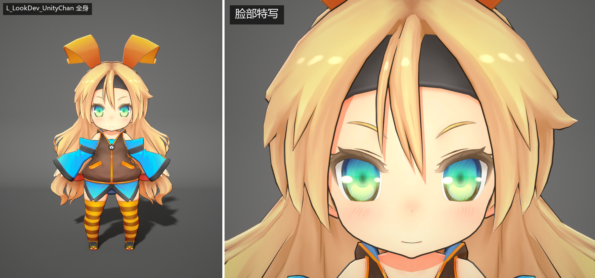

*示例工程 `MooaToon-Project` 的 `L_LookDev_UnityChan` 关卡，当前 5.7 分支实拍。描边、头发高光、硬边明暗和刘海落在额头上的投影，都由下文介绍的引擎改动提供。（UnityChan © UTJ/UCL）*

UE5 的延迟渲染管线是为 PBR 设计的：明暗过渡由物理 BRDF 决定，阴影、GI、反射、曝光都按"物理正确"计算，材质能写进 GBuffer 的数据也是固定的。做三渲二时，只靠后处理或自发光材质可以绕开这些限制，但同时也放弃了 Lumen、虚拟阴影贴图、光追阴影、多光源这些原生光照能力。

MooaToon 的思路相反：**留在延迟管线里，给引擎加一个真正的 Toon 着色模型**，让卡通材质和 PBR 场景共用同一套灯光、阴影和 GI，再把"不想要物理正确"的地方逐个开出控制口。这篇文章按功能逐项说明：改了哪些文件、这些文件在引擎里负责什么、关键代码是怎么改的、每段代码是什么意思、换来了什么。

> **关于配图**
>
> - **实拍图**（题图和标注"5.7 实拍"的 6 张图）：在当前 5.7 分支的编辑器里打开示例关卡截取。对比图是**同一个魔改引擎里开关某项功能或调某个参数**的前后对比，不是原版引擎的渲染结果。示例资产依赖新增的着色模型和材质引脚，在原版引擎里无法正确渲染，所以做不出"原版与修改版同一场景"的 A/B 图；与原版的差别以能力表和代码 diff 的形式给出。
> - **README 旧图**（标注"README 截图，早期版本"）：来自仓库 README，是 2022 年的版本，材质面板上的参数名和布局与当前分支不一定一致，请以当前工程里的 `M_Toon` 为准。
> - **整理与生成的图**：SDF 阈值图和 ID 贴图由示例工程 Art 目录的原始文件整理；统计图和 GBuffer 位布局图根据当前代码生成。
>
> **关于代码**
>
> 文中的代码都取自 MooaToon-Engine 与 UE 5.7.4 的逐文件 diff。代码块首行的注释是相对 `Engine/` 的路径和修改版中的行号；`diff` 块里 `-` 是原版、`+` 是修改版。重复性的改动只贴一处代表，省略的部分用中文注释标明。

## 1. 对比基线与方法

| 项目 | 内容 |
|---|---|
| 修改后的引擎 | `MooaToon-Engine`，分支 `5.7`，`Build.version` 为 5.7.4 |
| 原版引擎 | Unreal Engine 5.7.4（Launcher 安装版，Changelist 51494982） |
| 对比范围 | `Engine/Shaders`、`Engine/Source/Runtime`、`Engine/Source/Editor`、`Engine/Source/Developer`、`Engine/Config` |
| 对比方法 | 逐文件比较，统一换行符后用 unified diff 统计增删行 |

结果：

- **修改 144 个已有文件**，新增 2450 行，删除 99 行。
- **新增 6 个文件**，共 985 行：两个 shader 头文件和四个 C++ 文件。
- 其余三万多个源文件与原版一致（另有 14 个文件只有换行符差异）。

删除的 99 行里有 46 行在 `BaseEngine.ini`，是安装版引擎自带的 `InstalledPlatformConfigurations` 等条目，属于基线差异，不是 MooaToon 的改动。也就是说整套改动几乎全是"加法"：所有改动都用 `// Mooa <功能名>` 和 `// Mooa End` 包起来，升级引擎版本时可以按标记逐块合并。

`Engine/Plugins` 另外单独对比了一次，结果在第 5 节，不计入上面的数字。

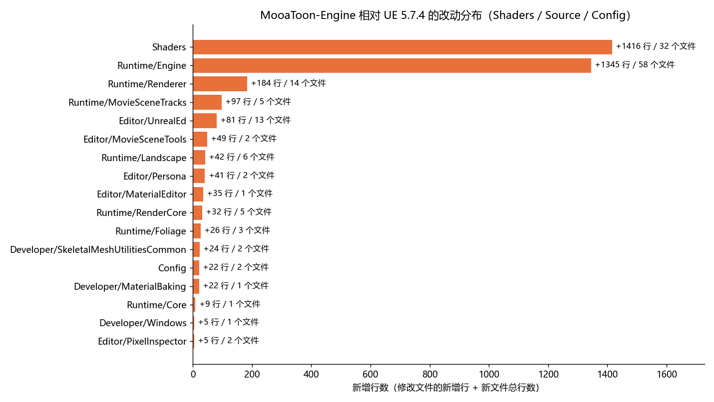

*改动量集中在 Shaders 和 Runtime/Engine：前者是着色逻辑本身，后者是材质系统、组件属性和后处理参数。Renderer 模块只动了 184 行。*

## 2. 原版 UE 5.7.4 与 MooaToon-Engine 能力对比

| 能力 | 原版 UE 5.7.4 | MooaToon-Engine |
|---|---|---|
| 着色模型 | ID 0 到 12，没有卡通模型 | 新增 `MSM_Toon`，shader 侧 `SHADINGMODELID_TOON = 13` |
| GBuffer | 标准 GBuffer A 到 E 加 Velocity | 额外一张 RGBA16 的 `ToonBufferA` |
| 材质输出引脚 | 固定的 PBR 属性 | 多 5 个 float4 引脚 `Mooa Encoded Attribute 0..4` |
| 明暗过渡 | Lambert，过渡形状不可控 | 采样全局 Diffuse Ramp 图集，每个材质选一行 |
| 暗部颜色 | 由灯光和 GI 决定 | 每材质的 Shadow Color，由 Ramp 的 alpha 混合 |
| 高光 | GGX | GGX、Ramp 风格化高光、Kajiya-Kay 头发高光三选一 |
| 边缘光 | 无 | 逐光源的屏幕空间深度测试边缘光 |
| 头发投在脸上的阴影 | 物理阴影，形状取决于发片模型 | 屏幕空间头发阴影，宽度和强度可调 |
| 脸部阴影 | 由法线决定 | SDF 阴影阈值图 |
| 自阴影 | 无法按部位关闭 | 光追阴影里按 5 bit Stencil 忽略自阴影或 Toon 间投影 |
| 阴影与 Lighting Channels | 只投到匹配的通道 | 可单独指定阴影投向哪些通道 |
| GI | 按物理叠加 | 强度、方向性、颜色覆盖、Lumen 法线压平都可调 |
| 反射 | 由粗糙度决定 | 每材质 Reflection Intensity |
| 曝光 | 全场景一致 | Toon 像素有独立的 Exposure Scale |
| 描边 | Overlay Material（正面） | 新增 Outline Material 槽，反向剔除渲染，带独立剔除距离 |
| Morph Target 法线 | 表情变形会改法线 | 每 LOD 可调强度，可设为 0 |

## 3. 改动总览：一条数据通路

所有功能都挂在同一条数据通路上。理解了它，后面每一节都只是这条通路上的一个节点。

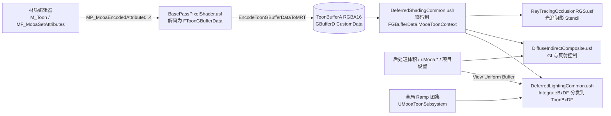

1. 美术在材质里把卡通参数接到 5 个新引脚上。
2. BasePass 把它们压缩后写进新增的 `ToonBufferA` 和原有的 CustomData。
3. 光照阶段解码，直接光走新的 `ToonBxDF`，间接光和光追阴影各自读取需要的字段。
4. 全局参数（后处理体积、控制台变量、Ramp 图集）通过 View Uniform Buffer 送到 shader。

## 4. 逐项拆解

### 4.1 新增 Toon 着色模型

**做法**：在引擎的着色模型枚举里追加 `MSM_Toon`，并把它登记到材质编译、shader 宏、GBuffer 写入规则等所有按着色模型分支的地方。

| 文件 | 在引擎中的职责 | 改动 |
|---|---|---|
| `Source/Runtime/Engine/Classes/Engine/EngineTypes.h` | 引擎公共枚举，`EMaterialShadingModel` 在这里 | 增加 `MSM_Toon`，显示名 Toon |
| `Shaders/Private/ShadingCommon.ush` | shader 侧的着色模型 ID 和调试颜色 | 增加 ID 13 和调试色 |
| `Shaders/Private/Definitions.usf` | 所有 shader 宏的默认值 | 增加 `MATERIAL_SHADINGMODEL_TOON` 默认值 |
| `Source/Runtime/RenderCore/Public/ShaderMaterial.h`、`Private/ShaderMaterialDerivedHelpers.cpp` | 把材质属性推导成编译期开关 | Toon 也写 CustomData |
| `Source/Runtime/Engine/Private/ShaderCompiler/ShaderGenerationUtil.cpp` | 生成材质 shader 的宏和 GBuffer 编解码代码 | 登记 Toon 宏 |
| `Source/Runtime/Engine/Private/Materials/HLSLMaterialTranslator.cpp` | 材质节点图到 HLSL 的翻译器 | 为 Toon 材质设置 define |
| `Source/Runtime/Engine/Private/Materials/MaterialShader.cpp` | 着色模型名称字符串 | 增加名称 |
| `Source/Runtime/Engine/Public/MaterialShared.h` | 材质公共判断函数 | `IsSubsurfaceShadingModel()` 把 Toon 计入"次表面类"模型 |
| `Shaders/Private/BasePassCommon.ush` | BasePass 公共宏 | `WRITES_CUSTOMDATA_TO_GBUFFER` 加入 Toon |
| `Shaders/Private/DeferredShadingCommon.ush` | GBuffer 的解码与判断函数 | `HasCustomGBufferData()` 加入 Toon |
| `Shaders/Private/ShadingModels.ush` | 各着色模型的 BxDF 与 `IntegrateBxDF` 分发 | include `ToonShadingModel.ush`，分发到 `ToonBxDF` |
| `Shaders/Private/ClusteredDeferredShadingPixelShader.usf` | 分簇延迟光照 | 接入 Toon |
| `Source/Editor/PixelInspector/Private/PixelInspectorResult.{h,cpp}` | 像素检查器 | 能识别 Toon 像素 |

**关键代码与含义**

第一步是在 C++ 和 shader 两侧各登记一个编号：

```cpp
// Source/Runtime/Engine/Classes/Engine/EngineTypes.h:728
MSM_Toon					UMETA(DisplayName="Toon"), // Mooa Toon Shading Model
```

```diff
 // Shaders/Private/ShadingCommon.ush:33
-#define SHADINGMODELID_NUM					13
+#define SHADINGMODELID_TOON					13		// Mooa Toon Shading Model
+#define SHADINGMODELID_NUM					14
 #define SHADINGMODELID_MASK					0xF		// 4 bits reserved for ShadingModelID
```

- `MSM_Toon` 插在 `MSM_Strata` 之后、`MSM_NUM` 之前，序号是 13；`UMETA(DisplayName="Toon")` 决定材质编辑器 Shading Model 下拉框里显示的名字。
- shader 侧的 `SHADINGMODELID_TOON` 必须和 C++ 枚举的序号一致。BasePass 把这个数字写进 GBuffer，光照阶段读出来决定走哪个 BxDF。
- 原版的 `SHADINGMODELID_NUM` 是 13，也就是 0 到 12 已用。掩码 `0xF` 说明 GBuffer 里只给着色模型留了 4 bit，最多 16 个，Toon 占掉 13 之后只剩 14 和 15 两个空位。

第二步是让材质编译器知道"这个材质用了 Toon"：

```cpp
// Source/Runtime/Engine/Private/Materials/HLSLMaterialTranslator.cpp:3050
// Mooa Toon Shading Model
if (EnvironmentDefines->HasShadingModel(MSM_Toon))
{
    OutEnvironment.SetDefine(TEXT("MATERIAL_SHADINGMODEL_TOON"), TEXT("1"));
}
```

```hlsl
// Shaders/Private/Definitions.usf:107
#ifndef MATERIAL_SHADINGMODEL_TOON
#define MATERIAL_SHADINGMODEL_TOON						0
#endif
```

- 翻译器把材质节点图翻译成 HLSL 时，顺带给 shader 编译环境加宏。只有选了 Toon 的材质才会得到 `MATERIAL_SHADINGMODEL_TOON=1`。
- `Definitions.usf` 给所有其他 shader 一个默认值 0。后面所有 Toon 专用代码都包在 `#if MATERIAL_SHADINGMODEL_TOON` 里，所以非 Toon 材质编译出的 shader 里不含这些代码。
- `ShaderGenerationUtil.cpp:133` 还有一行 `FETCH_COMPILE_BOOL(MATERIAL_SHADINGMODEL_TOON);`，作用是把这个宏读回 C++ 侧的材质属性结构，4.2 节推导 GBuffer 布局时要用。

第三步是把光照计算分发到新的 BxDF：

```hlsl
// Shaders/Private/ShadingModels.ush:1072
// Mooa Toon Shading Model
#if !SHADING_PATH_MOBILE
    #include "ToonShadingModel.ush"
#endif
// Mooa End
// 以下在约 1104 行，IntegrateBxDF 的 switch 里
        // Mooa Toon Shading Model
#if !SHADING_PATH_MOBILE
        case SHADINGMODELID_TOON:
            return ToonBxDF(GBuffer, N, V, AreaLight, Shadow);
#endif
```

- `IntegrateBxDF` 是延迟光照里"每个光源对每个像素"都会调用的入口，按 GBuffer 里的着色模型 ID 做 `switch`。加一个 `case`，Toon 就接入了平行光、点光、聚光、矩形光的全部光照流程。
- `#if !SHADING_PATH_MOBILE` 把移动端渲染路径排除在外，这也是第 6 节说"未接入移动端"的依据。

最后是几处"归类"，决定 Toon 能用哪些现成的通道：

```cpp
// Source/Runtime/Engine/Public/MaterialShared.h:125
inline bool IsSubsurfaceShadingModel(FMaterialShadingModelField ShadingModel)
{
    return ShadingModel.HasShadingModel(MSM_Subsurface) || ShadingModel.HasShadingModel(MSM_PreintegratedSkin) ||
        ShadingModel.HasShadingModel(MSM_SubsurfaceProfile) || ShadingModel.HasShadingModel(MSM_TwoSidedFoliage) ||
        ShadingModel.HasShadingModel(MSM_Cloth) || ShadingModel.HasShadingModel(MSM_Eye)
        // Mooa
        || ShadingModel.HasShadingModel(MSM_Toon);
}
```

- 这个函数被引擎用来判断"是不是次表面类材质"。把 Toon 算进去有两个直接效果：材质根节点的 Opacity 引脚对 Toon 亮起（`Material.cpp:7870`），翻译器会为 Toon 编译 SubsurfaceColor 属性（`HLSLMaterialTranslator.cpp:1974`）。
- shader 侧对应的判断是 `DeferredShadingCommon.ush:324` 的 `HasCustomGBufferData()`，末尾加了 `|| ShadingModelID == SHADINGMODELID_TOON`；`BasePassCommon.ush:44` 的 `WRITES_CUSTOMDATA_TO_GBUFFER` 宏也加入了 `MATERIAL_SHADINGMODEL_TOON`。两处合起来的意思是：Toon 像素会写、也会读 GBuffer 的 CustomData 通道，4.2 节用它存阴影色。

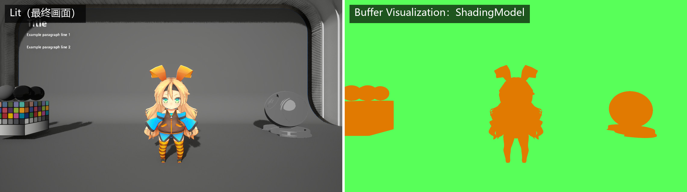

*5.7 实拍。左：示例关卡的 Lit 视图。右：同一视角切到 Buffer Visualization 的 Shading Model 视图，角色、色卡和材质球显示为橙色（`ShadingCommon.ush:85` 给 Toon 定义的调试色 `float3(0.75f, 0.2f, 0.0f)`），场景里的 Default Lit 物体是绿色。两类像素在同一个 GBuffer 里共存。*

**好处**：Toon 成为和 Default Lit、Subsurface 平级的一等着色模型。它享有逐光源的延迟光照，一个场景里卡通角色和 PBR 环境可以共存，材质编辑器里只是下拉框多了一项。

### 4.2 多一张 GBuffer：ToonBufferA

原版 GBuffer 留给自定义数据的只有 CustomData 的 4 个 8 bit 通道，装不下卡通渲染需要的参数。MooaToon 追加了一张 RGBA16 Unorm 的渲染目标 `ToonBufferA`，64 bit 加上 CustomData 的 32 bit，按位打包了 13 个字段：

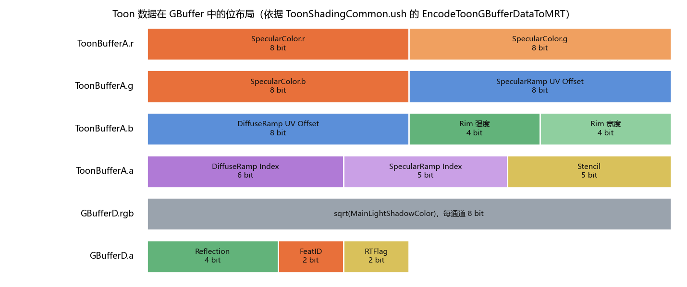

| 文件 | 在引擎中的职责 | 改动 |
|---|---|---|
| `Source/Runtime/RenderCore/Public/GBufferInfo.h`、`Private/GBufferInfo.cpp` | 描述 GBuffer 有哪些 slot、RT 格式和打包方式 | 增加 `GBS_MooaToonDataA` 与 `ToonBufferA` 绑定 |
| `Source/Runtime/RenderCore/Private/ShaderMaterialDerivedHelpers.cpp` | 决定 BasePass 输出哪些 MRT | 始终多挂 1 个 RT，后面的 MRT 顺移 |
| `Source/Runtime/Engine/Private/ShaderCompiler/ShaderGenerationUtil.cpp` | 生成 GBuffer 编解码代码，决定每种着色模型写哪些 slot | Toon 写 CustomData 和 `GBS_MooaToonDataA` |
| `Source/Runtime/Engine/Public/SceneTexturesConfig.h` 及 `.cpp` | 场景纹理的全局配置 | 增加绑定项 |
| `Source/Runtime/Renderer/Internal/SceneTextures.h`、`Private/SceneTextures.cpp` | 场景纹理的创建、绑定和 Uniform Buffer | 创建并绑定 `ToonBufferA` |
| `Source/Runtime/Renderer/Private/SceneTextureParameters.{h,cpp}`、`Public/SceneRenderTargetParameters.h` | 传给各个渲染 pass 的场景纹理参数 | 增加纹理和 `ToonBufferA` 标志位 |
| `Source/Runtime/Renderer/Private/SceneRendering.{h,cpp}`、`PlanarReflectionRendering.cpp`、`IndirectLightRendering.cpp` | 场景渲染主流程、平面反射、间接光 | 把新纹理传下去 |
| `Shaders/Private/DeferredShadingCommon.ush` | `FGBufferData` 的定义和解码 | 增加 `MooaToonContext` 并解码 |
| `Shaders/Private/GBufferHelpers.ush`、`SceneTexturesCommon.ush` | GBuffer 采样辅助 | 增加 `ToonBufferA` 采样 |
| `Shaders/Private/BasePassPixelShader.usf` | BasePass 像素着色器，负责写 GBuffer | 解码材质引脚，编码写入 MRT |
| `Shaders/Private/ScreenSpaceDenoise/SSDCommon.ush`、`RayTracing/RayTracingDeferredShadingCommon.ush` | 降噪与光追延迟着色的 GBuffer 读取 | 同步新字段 |
| `Source/Runtime/Renderer/Private/SingleLayerWaterRendering.cpp` | 单层水渲染 | `r.Water.SingleLayer.ForceVelocity` 默认值由 1 改为 0 |

**关键代码与含义**

**(1) 注册一张新的渲染目标**

```cpp
// Source/Runtime/RenderCore/Private/GBufferInfo.cpp:417
// Mooa GBuffer
Info.NumTargets++;
uint32 TargetToonBufferA = Info.NumTargets - 1;
Info.Targets[TargetToonBufferA].Init(GBT_Unorm_16_16_16_16,  TEXT("ToonBufferA"), false,  true,  true,  true);
Info.Slots[GBS_MooaToonDataA] = FGBufferItem(GBS_MooaToonDataA, GBC_Raw_Float_16_16_16_16, GBCH_Both);
Info.Slots[GBS_MooaToonDataA].Packing[0] = FGBufferPacking(TargetToonBufferA, 0, 0);
Info.Slots[GBS_MooaToonDataA].Packing[1] = FGBufferPacking(TargetToonBufferA, 1, 1);
Info.Slots[GBS_MooaToonDataA].Packing[2] = FGBufferPacking(TargetToonBufferA, 2, 2);
Info.Slots[GBS_MooaToonDataA].Packing[3] = FGBufferPacking(TargetToonBufferA, 3, 3);
// Mooa End
```

- UE5 的 GBuffer 布局是数据驱动的：`FGBufferInfo` 描述有几张 RT（Target）、有哪些逻辑数据（Slot）、每个 Slot 的每个通道落在哪张 RT 的哪个通道（Packing），引擎据此自动生成编解码 shader。
- `NumTargets++` 在已有 RT 的末尾追加一张，格式是每通道 16 bit 的无符号归一化值。
- 新的 Slot `GBS_MooaToonDataA`（在 `GBufferInfo.h:43` 的枚举里新增）以"原始 4 通道"方式存放，四行 `Packing` 把它的 4 个通道原样对应到 `ToonBufferA` 的 RGBA。位打包由 MooaToon 自己的 shader 函数完成，引擎不参与。

**(2) BasePass 的输出槽整体后移一位**

```cpp
// Source/Runtime/RenderCore/Private/ShaderMaterialDerivedHelpers.cpp:172
// Mooa GBuffer: We always attach an additional RT
// if (Mat.MATERIAL_SHADINGMODEL_TOON)
{
    Dst.PIXELSHADEROUTPUT_MRT7 = Dst.PIXELSHADEROUTPUT_MRT6;
    Dst.PIXELSHADEROUTPUT_MRT6 = Dst.PIXELSHADEROUTPUT_MRT6 || Dst.PIXELSHADEROUTPUT_MRT5; 
    Dst.PIXELSHADEROUTPUT_MRT5 = Dst.PIXELSHADEROUTPUT_MRT5 || Dst.PIXELSHADEROUTPUT_MRT4; 
    Dst.PIXELSHADEROUTPUT_MRT4 = Dst.PIXELSHADEROUTPUT_MRT4 || Dst.PIXELSHADEROUTPUT_MRT3; 
}
```

- `PIXELSHADEROUTPUT_MRTn` 这组宏决定 BasePass 像素着色器声明几个输出。多了一张 RT，就要多声明一个输出，原来用到第 n 个的现在用到第 n+1 个。
- 注意条件 `if (Mat.MATERIAL_SHADINGMODEL_TOON)` 被注释掉了，所以**所有材质**的 BasePass 都多一个输出，不只是 Toon 材质。原因是同一个 pass 里各个材质绑定的是同一组渲染目标，RT 数量必须一致。这也是第 6 节"显存和带宽"那一条的由来。
- 相应地，`ShaderGenerationUtil.cpp:1755` 规定 Toon 着色模型写哪些 Slot：

```cpp
// Source/Runtime/Engine/Private/ShaderCompiler/ShaderGenerationUtil.cpp:1755
case MSM_Toon:
    SetSharedGBufferSlots(Slots);
    Slots[GBS_CustomData] = true;
    Slots[GBS_MooaToonDataA] = true;
    break;
```

**(3) 13 个字段怎么塞进 96 bit**

```hlsl
// Shaders/Private/ToonShadingCommon.ush:315
/*
 * ToonBufferA (RGBA Float 16)
 * x: SpecularColor.r(8)			SpecularColor.g(8)
 * y: SpecularColor.b(8)			SpecularColorRampUVOffset(8)
 * z: DiffuseColorRampUVOffset(8)	RimLightIntensity(4)		RimLightWidth(4)
 * w: DiffuseColorRampIndex(6)		SpecularColorRampIndex(5)	Stencil(5)
 * 
 * CustomData (GBufferD) (RGBA Float 8)
 * x: MainLightShadowColor.r(8)
 * y: MainLightShadowColor.g(8)
 * z: MainLightShadowColor.b(8)
 * w: ReflectionIntensity(4)	ShadingFeatureID(2)		RayTracingShadowFlag(2)
 *
 * Metallic:	FacialShadowSdfLeft(8)
 * Anisotropy:	FacialShadowSdfRight(8)
 */
void EncodeToonGBufferDataToMRT(FToonGBufferData ToonGBuffer,
    out float4 EncodedToonBufferA, out float4 CustomData, inout float Metallic)
{
    EncodedToonBufferA.x = EncodeFloat2ToFloat(ToonGBuffer.SpecularColor.r, ToonGBuffer.SpecularColor.g);
    EncodedToonBufferA.y = EncodeFloat2ToFloat(ToonGBuffer.SpecularColor.b, ToonGBuffer.SpecularColorRampUVOffset);
    EncodedToonBufferA.z = EncodeFloat2ToFloat(
        ToonGBuffer.DiffuseColorRampUVOffset,
        EncodeFloat2ToFloat(ToonGBuffer.RimLightIntensity, ToonGBuffer.RimLightWidth, 4, 4),
        8, 8);
    EncodedToonBufferA.w = EncodeUint2ToFloat(
        EncodeUint2ToUint(ToonGBuffer.DiffuseColorRampIndex, ToonGBuffer.SpecularColorRampIndex, 6, 5),
        ToonGBuffer.Stencil,
        11, 5
    );

    CustomData.xyz = sqrt(saturate(ToonGBuffer.MainLightShadowColor.rgb));
    CustomData.w = EncodeUint2ToFloat(
        EncodeFloatToUint(ToonGBuffer.ReflectionIntensity, 4),
        EncodeUint2ToUint(ToonGBuffer.ShadingFeatureID, ToonGBuffer.RayTracingShadowFlag, 2, 2),
        4, 4
    );

    BRANCH if (ToonGBuffer.ShadingFeatureID == MOOA_SHADING_FEATURE_ID_DISTANCE_FIELD_FACIAL_SHADOW)
    {
        Metallic = ToonGBuffer.FacialShadowSdfLeft;
    }
}
```

- 开头的注释就是位布局表，和上面的图一一对应。每个 16 bit 通道拆成两个 8 bit，或者 8+4+4、6+5+5 的组合。
- Ramp 索引给了 6 bit 和 5 bit，所以全局 Diffuse Ramp 图集最多 64 行，Specular Ramp 图集最多 32 行；Stencil 是 5 bit，最多 32 组。
- `MainLightShadowColor` 开方后存储，解码时平方（`Square(saturate(CustomData.xyz))`）。8 bit 线性存储在暗部容易出色阶，开方相当于一次 gamma 编码，把精度让给暗色。
- `ShadingFeatureID` 只有 2 bit，取值是默认、PBR 高光、Kajiya 头发高光、SDF 面部阴影四种，互斥。
- SDF 面部阴影模式已经没有多余的位，于是借用 `Metallic` 存左脸 SDF、借用 GBufferF 的 `Anisotropy` 存右脸 SDF。解码时取出后把这两个通道还原成 `Metallic = 0`、各向异性为 0，所以这种模式下脸部材质不能再用金属度和各向异性。

实际做位运算的是一组小工具函数：

```hlsl
// Shaders/Private/ToonShadingCommon.ush:167
uint GetBitsMaxValue(int Bits = 8) {return (1L << Bits) - 1;}

uint EncodeUint2ToUint(uint Src1, uint Src2, int BitsSrc1 = 8, int BitsSrc2 = 8)
{
    return ((Src1 & GetBitsMaxValue(BitsSrc1)) << BitsSrc2) |
    (Src2 & GetBitsMaxValue(BitsSrc2));
}

float EncodeUint2ToFloat(uint Src1, uint Src2, int BitsSrc1 = 8, int BitsSrc2 = 8)
{
    return float(EncodeUint2ToUint(Src1, Src2, BitsSrc1, BitsSrc2)) / GetBitsMaxValue(BitsSrc1 + BitsSrc2);
}

void DecodeUint2FromFloat(float Src, out uint Dst1, out uint Dst2, int BitsDst1 = 8, int BitsDst2 = 8, float bias = 0)
{
    uint FloatToUint = uint(Src * GetBitsMaxValue(BitsDst1 + BitsDst2) + bias);
    DecodeUint2FromUint(FloatToUint, Dst1, Dst2, BitsDst1, BitsDst2);
}
```

- 编码：两个整数先各自按位数截断，再用移位和按位或拼成一个 16 bit 整数，最后除以 65535 变成 0 到 1 的浮点数。这一步是必须的，因为 RT 是 Unorm 格式，只能存 0 到 1。
- 解码：乘回 65535 还原成整数，再移位拆开。解码处统一传了 `bias = 0.5`，等价于四舍五入，用来抵消浮点误差，否则 65534.9999 会被截成 65534，高位字段整个错掉。

**(4) BasePass 写入，光照阶段读回**

```hlsl
// Shaders/Private/BasePassPixelShader.usf:2358
#if MATERIAL_SHADINGMODEL_TOON
    BRANCH if (GBuffer.ShadingModelID == SHADINGMODELID_TOON)
    {
        GBuffer.GenericAO = MaterialAO;
        EncodeToonGBufferDataToMRT(GBuffer.MooaToonContext.ToonGBuffer,
            GBuffer.MooaToonContext.EncodedToonBufferA, GBuffer.CustomData, GBuffer.Metallic);
    }
#endif
```

```hlsl
// Shaders/Private/DeferredShadingCommon.ush:1064
// Mooa GBuffer Decode
BRANCH if (GBuffer.ShadingModelID == SHADINGMODELID_TOON)
{
    GBuffer.MooaToonContext.ToonGBuffer = DecodeToonGBufferDataFromMRT(InToonBufferA, GBuffer.CustomData, GBuffer.Metallic, InGBufferF.a);
    InitMooaToonContext(GBuffer);
}
```

- 写入发生在引擎自己的 `EncodeGBufferToMRT` 之前：先把 Toon 数据编码进 `EncodedToonBufferA`、`CustomData` 和 `Metallic`，引擎随后按 (1) 里登记的 Packing 把它们写到对应的 RT。
- 读回发生在 `DecodeGBufferData` 里，它是所有延迟 pass 读取 GBuffer 的公共函数，MooaToon 给它加了一个参数 `InToonBufferA`。解码后的结构放在 `FGBufferData` 新增的成员 `MooaToonContext` 里，于是任何拿到 `FGBufferData` 的地方（直接光、间接光、光追阴影）都能读到卡通参数。
- 采样 `ToonBufferA` 用的是 `ToonBufferATexture.Load(...)` 而不是带过滤的采样。位打包的数据不能做双线性插值，两个相邻像素的整数插值出来是没有意义的第三个整数。

**(5) 为第 8 张 RT 腾位置**

```diff
 // Source/Runtime/Renderer/Private/SingleLayerWaterRendering.cpp:153
-	TEXT("r.Water.SingleLayer.ForceVelocity"), 1,
+	TEXT("r.Water.SingleLayer.ForceVelocity"), 0, // Mooa GBuffer: Disable to avoid GBuffer numbers exceeding 8
```

- 一个像素着色器最多同时写 8 张 RT。原版里单层水材质会强制输出 Velocity，加上 `ToonBufferA` 就超了，所以把这个控制台变量的默认值改成 0。

**好处**：卡通参数是逐像素、逐材质的，并且在延迟光照阶段可读。这是"每个光源都能做卡通着色"和"屏幕空间效果能读到邻近像素的卡通属性"的前提。

**代价**：见第 6 节。(2) 的无条件后移和 (5) 的水体改动都是代价的一部分。

### 4.3 材质编辑器：5 个新引脚

**做法**：给材质根节点追加 5 个 float4 属性 `MP_MooaEncodedAttribute0..4`，共 20 个浮点通道，默认值全 0。

| 文件 | 在引擎中的职责 | 改动 |
|---|---|---|
| `Source/Runtime/Engine/Public/SceneTypes.h` | `EMaterialProperty` 枚举 | 增加 5 个属性 |
| `Source/Runtime/Engine/Public/Materials/Material.h`、`Private/Materials/Material.cpp` | `UMaterial` 及其输入 | 增加 5 个输入和可见性规则 |
| `Source/Runtime/Engine/Private/Materials/MaterialAttributeDefinitionMap.cpp` | 材质属性的 GUID、类型、默认值和显示名 | 注册 5 个属性 |
| `Source/Runtime/Engine/Private/Materials/HLSLMaterialTranslator.cpp`、`MaterialCachedData.cpp`、`MaterialExpressions.cpp` | 材质翻译、缓存和表达式节点 | 让新属性参与编译，Make/Break Material Attributes 可用 |
| `Shaders/Private/MaterialTemplate.ush` | 材质 shader 模板 | 生成 `GetMaterialMooaEncodedAttributeN` |
| `Source/Editor/MaterialEditor/Private/MaterialEditor.cpp`、`Source/Editor/UnrealEd/Private/MaterialGraph.cpp`、`MaterialGraphNode_Root.cpp` | 材质编辑器界面和根节点 | 显示新引脚 |
| `Source/Developer/MaterialBaking/Private/ExportMaterialProxy.h` | 材质烘焙导出 | 兼容新属性 |

**关键代码与含义**

在 UE 里给材质加一个输出引脚，要沿着"枚举、属性表、`UMaterial` 成员、可见性、翻译器、shader 模板、编辑器界面"改一整条链。5 个引脚的代码完全同构，下面每处只贴第 0 个。

**(1) 枚举和属性表**

```cpp
// Source/Runtime/Engine/Public/SceneTypes.h:182
// Mooa Material Editor
MP_MooaEncodedAttribute0 UMETA(DisplayName = "Mooa Encoded Attribute 0"),
```

```cpp
// Source/Runtime/Engine/Private/Materials/MaterialAttributeDefinitionMap.cpp:355
Add(FGuid(0xC1A0EA03, 0x15C74A55, 0xB852BAD5, 0x9A20789A), TEXT("MooaEncodedAttribute0"),			MP_MooaEncodedAttribute0,			MCT_Float4,	FVector4(0,0,0,0),	SF_Pixel);
```

- `EMaterialProperty` 是材质属性的总枚举，新成员加在 `MP_Displacement` 之后。
- 属性表里的一行登记了这个属性的全部元信息：固定的 GUID（Make、Break、Set Material Attributes 节点靠 GUID 识别属性，所以每个引脚要有一个唯一且不再变化的值）、内部名、类型 `MCT_Float4`、默认值全 0、求值阶段 `SF_Pixel`（只在像素着色器里计算）。
- `Material.cpp:3136` 的 `static_assert(MP_MAX == 40, ...)` 也随之从 35 改成了 40。这是引擎留的一道检查，提醒"加了属性就要同步处理引脚重排"，对应的 5 行 `DoMaterialAttributeReorder` 在 `Material.cpp:4464`。

**(2) 引脚什么时候亮起**

```diff
 // Source/Runtime/Engine/Private/Materials/Material.cpp:7876
        case MP_OpacityMask:
-			Active = IsMaskedBlendMode(BlendMode);
+			Active = IsMaskedBlendMode(BlendMode)
+					|| ShadingModels.HasShadingModel(MSM_Toon); // Mooa Ray Tracing Shadow
            break;
        case MP_CustomData0:
-			Active = ShadingModels.HasAnyShadingModel({ MSM_ClearCoat, MSM_Hair, MSM_Cloth, MSM_Eye, MSM_SubsurfaceProfile });
+			Active = ShadingModels.HasAnyShadingModel({ MSM_Toon, MSM_ClearCoat, MSM_Hair, MSM_Cloth, MSM_Eye, MSM_SubsurfaceProfile });
            break;
+		case MP_MooaEncodedAttribute0:
+		case MP_MooaEncodedAttribute1:
+		case MP_MooaEncodedAttribute2:
+		case MP_MooaEncodedAttribute3:
+		case MP_MooaEncodedAttribute4:
+			Active = ShadingModels.HasAnyShadingModel({ MSM_Toon });
+			break;
```

- 这是 `UMaterial::IsPropertyActive` 的节选，它决定材质根节点上哪些引脚可用、哪些置灰。
- 5 个新引脚只在着色模型选 Toon 时亮起，对其他材质没有任何可见变化。
- Toon 还顺带点亮了几个原有引脚：`OpacityMask`（不透明的 Toon 材质也能输出遮罩，给 4.7 节的光追任意命中着色器用）、`CustomData0`（存光追阴影的 Stencil 和标志位）、`CustomData1`、`Tangent`、`Anisotropy`、`SubsurfaceColor`。后四个的改法相同，都是在 `HasAnyShadingModel` 的列表里加上 `MSM_Toon`。

**(3) 编译进 shader**

```cpp
// Source/Runtime/Engine/Private/Materials/HLSLMaterialTranslator.cpp:1961
// Mooa Material Editor
if (MaterialShadingModels.HasShadingModel(MSM_Toon))
{
    Chunk[MP_MooaEncodedAttribute0] = Material->CompilePropertyAndSetMaterialProperty(MP_MooaEncodedAttribute0, this);
    // 1 到 4 同构，此处省略
}
```

```hlsl
// Shaders/Private/MaterialTemplate.ush:3780
float4 GetMaterialMooaEncodedAttribute0(FPixelMaterialInputs PixelMaterialInputs)
{
    return PixelMaterialInputs.MooaEncodedAttribute0;
}
```

- 翻译器只在材质用了 Toon 时才编译这 5 个属性，把连到引脚上的节点图翻译成 HLSL 代码块（Chunk）。
- 模板里的 `GetMaterialMooaEncodedAttributeN` 是 shader 读取引脚值的统一入口。BasePass、各向异性 pass 和光追命中着色器都通过它拿到材质输出。
- 引脚没有连线时，`MaterialAttributeDefinitionMap.cpp:80` 返回常量 `Compiler->Constant4(0.0f, 0.0f, 0.0f, 0.0f)`。

**(4) BasePass 里解码**

```hlsl
// Shaders/Private/BasePassPixelShader.usf:1161
// Mooa Encode GBuffer
#if MATERIAL_SHADINGMODEL_TOON
    BRANCH if (ShadingModel == SHADINGMODELID_TOON)
    {
        GBuffer.MooaToonContext.ToonGBuffer = DecodeToonGBufferDataFromMaterialAttribute(
            GetMaterialMooaEncodedAttribute0(PixelMaterialInputs),
            GetMaterialMooaEncodedAttribute1(PixelMaterialInputs),
            GetMaterialMooaEncodedAttribute2(PixelMaterialInputs),
            GetMaterialMooaEncodedAttribute3(PixelMaterialInputs),
            GetMaterialMooaEncodedAttribute4(PixelMaterialInputs));
        
        InitMooaToonContext(GBuffer);
    }
#endif
```

- 5 个 float4 在这里被还原成有名字的结构 `FToonGBufferData`，之后才进入 4.2 节的位打包。也就是说引脚上传的是未压缩的浮点值，压缩只发生在写 GBuffer 的那一刻。

5 个引脚的通道分配（`ToonShadingCommon.ush:263` 的 `EncodeToonGBufferDataToMaterialAttribute`）：

| 引脚 | x | y | z | w |
|---|---|---|---|---|
| Attribute 0 | ShadingFeatureID | MainLightShadowColor.r | MainLightShadowColor.g | MainLightShadowColor.b |
| Attribute 1 | DiffuseColorRampIndex | DiffuseColorRampUVOffset | 未使用 | 未使用 |
| Attribute 2 | SpecularColor.r | SpecularColor.g | SpecularColor.b | SpecularColorRampIndex |
| Attribute 3 | SpecularColorRampUVOffset | ReflectionIntensity | RimLightIntensity | RimLightWidth |
| Attribute 4 | FacialShadowSdfLeft | FacialShadowSdfRight | Stencil | RayTracingShadowFlag |

工程插件里的材质函数 `MF_MooaEncodeAttributes`、`MF_MooaDecodeAttributes`、`MF_MooaSetAttributes` 负责把有名字的参数（阴影色、Ramp 索引、边缘光宽度等）装进这 5 个引脚，美术不需要直接面对上面这张表。

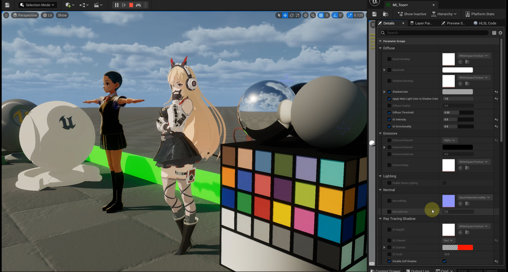

*示例工程的 LookDev 关卡和 `MI_Toon` 材质实例。Shadow Color、GI Intensity、GI Directionality、光追阴影的 ID Map 与 Disable Self Shadow 等参数最终都通过上述引脚进入 GBuffer。（README 截图，早期版本）*

**好处**：引擎只提供"通道"，卡通逻辑怎么组合留给材质图。配合材质层（`ML_ToonBaseInput`、`MLB_ToonBaseBlend`），日式赛璐璐和带 GI 的美式卡通可以用同一套引擎改动实现。Attribute 1 还空着两个通道，后续加参数不需要再动材质系统。

### 4.4 ToonBxDF：直接光照

这是整套改动的核心，全部在两个新文件里：

| 新文件 | 行数 | 内容 |
|---|---|---|
| `Shaders/Private/ToonShadingCommon.ush` | 478 | 常量、位打包工具、`FToonGBufferData`、GBuffer 编解码、`FMooaToonContext`、光追负载 `FMooaCustomPayload` |
| `Shaders/Private/ToonShadingModel.ush` | 402 | `ToonBxDF` 及其用到的头发阴影、面部 SDF、高光拟合、边缘光函数 |

`ToonBxDF` 的函数签名和引擎自带的 `DefaultLitBxDF` 等完全一致，对每个光源调用一次，返回这个光源贡献的漫反射和高光。下面按执行顺序拆开看。

**(0) 准备：光色、N·L 和"屏幕上的光方向"**

```hlsl
// Shaders/Private/ToonShadingModel.ush:276
FDirectLighting ToonBxDF(FGBufferData GBuffer, half3 N, half3 V, FAreaLight AreaLight, FShadowTerms Shadow)
{
    FMooaToonContext MooaToonContext = GBuffer.MooaToonContext;
    FToonGBufferData ToonGBuffer = GBuffer.MooaToonContext.ToonGBuffer;
    FDirectLighting Lighting = (FDirectLighting)0;
    float3 LightColorAndAttenuation = AreaLight.FalloffColor * MooaToonContext.LightColor * AreaLight.Falloff;
    ColorSaturationPowerAndScale(LightColorAndAttenuation, View.MooaLightSaturationScale);

    const float NoL_Full = dot(N, AreaLight.DiffuseL);
    const float NoL_Half = NoL_Full * 0.5f + 0.5f;
    const float3 H = normalize(V + AreaLight.SpecularL);
    const float3 L_ClipSpace = mul(AreaLight.DiffuseL, (float3x3)View.TranslatedWorldToClip).xyz;
    const float2 L_ViewportSpace = (L_ClipSpace.xy * float2(0.5, -0.5));
    const float2 L_ViewportOffsetBase = L_ViewportSpace * rcp(GBuffer.Depth);
```

- `MooaToonContext.LightColor` 是延迟光照阶段塞进来的光色（见 4.5 节）。原版在 BxDF 外面乘光色，这里拿进来自己乘，紧接着用后处理参数 Light Saturation Scale 调整饱和度，可以让有色灯光打在角色上不那么"脏"。
- `NoL_Half` 是半兰伯特：把 −1 到 1 的 N·L 映射到 0 到 1，背光面也有可用的梯度，正好做 Ramp 的横坐标。
- 最后三行把世界空间的光方向变换到屏幕空间，再除以像素深度。得到的 `L_ViewportOffsetBase` 是"朝着光源方向在屏幕上走一步"的偏移量，离相机越远步子越小，保证效果在世界空间里宽度大致恒定。头发阴影和边缘光都靠它做屏幕空间采样。

**(1) 漫反射：采样 Ramp 而不是算 Lambert**

```hlsl
// Shaders/Private/ToonShadingModel.ush:294（节选：省略了英文注释和开发版着色器里的调试覆盖）
const bool EnablePostRampShadow = View.MooaDiffuseColorRampEnablePostRampShadow;
const bool EnablePostRampMaterialAO = View.MooaDiffuseColorRampEnablePostRampMaterialAO;

float DiffuseColorRampUVOffset = (ToonGBuffer.DiffuseColorRampUVOffset * 2.0f - 1.0f) * View.MooaDiffuseColorRampUVOffsetMaxRange;
float ShadowGradient = saturate(NoL_Half + DiffuseColorRampUVOffset);
float HairLinearShadowGradient = GetScreenSpaceDepthTestHairShadow(MooaToonContext, GBuffer, ToonGBuffer, MooaToonContext.ViewportUV, L_ViewportOffsetBase);
ApplyDistanceFieldFacialShadow(MooaToonContext, GBuffer, ToonGBuffer, AreaLight.DiffuseL, DiffuseColorRampUVOffset, /*inout*/ ShadowGradient);

float OutLinearShadow = min(Shadow.SurfaceShadow, HairLinearShadowGradient);
float CustomLinearShadowGradient = 1.0f;
if (!EnablePostRampMaterialAO) CustomLinearShadowGradient = min(CustomLinearShadowGradient, GBuffer.GBufferAO);
if (!EnablePostRampShadow) CustomLinearShadowGradient = min(CustomLinearShadowGradient, OutLinearShadow);

float DiffuseColorRampU = min(ShadowGradient, LinearToDotProductSpace(CustomLinearShadowGradient));
// RGB: Diffuse Color for multiplication. A: Blending Factor of Diffuse Color and Shadow Color.
half4 DiffuseColorRamp = SampleGlobalRamp(View.MooaGlobalDiffuseColorRampAtlas, DiffuseColorRampU, ToonGBuffer.DiffuseColorRampIndex, View.MooaGlobalDiffuseColorRampAtlasHeight);

float DiffuseShadow = DiffuseColorRamp.a;
if (EnablePostRampMaterialAO) DiffuseShadow = min(DiffuseShadow, GBuffer.GBufferAO);
if (EnablePostRampShadow) DiffuseShadow = min(DiffuseShadow, OutLinearShadow);

half3 ToonDiffuseColor = GBuffer.DiffuseColor;
half3 ToonShadowColor = ToonGBuffer.MainLightShadowColor * (1.0f - GBuffer.Metallic) * GetShadowColorIntensity(MooaToonContext);
ToonDiffuseColor = lerp(ToonShadowColor, ToonDiffuseColor, DiffuseShadow);

Lighting.Diffuse = Diffuse_Lambert(ToonDiffuseColor) * DiffuseColorRamp.rgb * LightColorAndAttenuation;
Shadow.SurfaceShadow = OutLinearShadow;
```

逐段含义：

- **U 坐标**：半兰伯特的 N·L 加上材质给的偏移量。GBuffer 里的偏移是 0 到 1，这里还原成 −1 到 1 再乘以最大范围（`r.Mooa.DiffuseColorRamp.UVOffsetMaxRange`，默认 0.25），用来整体推移明暗交界线。
- **阴影并入 U 坐标**：引擎算好的投影 `Shadow.SurfaceShadow`、头发阴影、材质 AO 取最小值后，默认在采样 Ramp **之前**并入 U 坐标（`min(ShadowGradient, ...)`）。结果是投影的边缘和明暗交界线走同一条 Ramp，过渡形状一致。两个控制台变量 `EnablePostRampShadow` 和 `EnablePostRampMaterialAO` 可以改成采样之后再乘，那样阴影边缘保持引擎原本的软硬。
- **采样**：材质的 Ramp 索引选图集里的一行，U 坐标选这一行上的位置。
- **混合**：Ramp 的 alpha 决定"底色"和"阴影色"的混合比例，RGB 再乘到结果上。阴影色乘了 `(1 - Metallic)`，金属没有漫反射，自然也没有阴影色；再乘 `GetShadowColorIntensity`，它按光源类型返回后处理体积里的 Shadow Color Intensity。
- **最后一行**把合并后的阴影写回 `Shadow.SurfaceShadow`，后面的高光和边缘光用它做遮蔽。

用到的两个小函数：

```hlsl
// Shaders/Private/ToonShadingModel.ush:17
half4 SampleGlobalRamp(Texture2D Tex, float U, uint index, float rampHeight)
{
    return Texture2DSampleLevel(Tex, GlobalBilinearClampedSampler, float2(U, (float(index) + 0.5f) * rcp(rampHeight)), 0);
}
// 以下在 58 行
// NoL == dot(NormalDir, LightDir) == cos(theta) == cos(The radian between N and L)
// In other words, NoL is not linear,
// so other linear ShadowGradients must be converted to the same space to ensure that the sampling results of Ramp are consistent
float LinearToDotProductSpace(float gradient01)
{
    return cos(saturate(gradient01) * PI) * -0.5f + 0.5f;
}
```

- `SampleGlobalRamp`：V 坐标是 `(行号 + 0.5) / 图集高度`，正好采在这一行的像素中心，不会和上下两行的 Ramp 混色。
- `LinearToDotProductSpace`：N·L 是夹角的余弦，不是线性量；而阴影值是线性的 0 到 1。两者要在同一条 Ramp 上取最小值，就得先把线性值换算到余弦空间，否则同样"半明半暗"的位置会采到 Ramp 的不同地方。

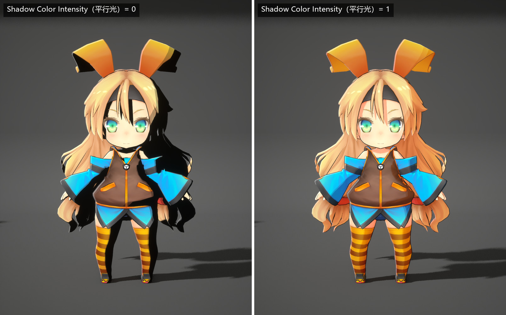

*5.7 实拍，同一魔改引擎内调参：后处理体积里平行光的 Shadow Color Intensity 设为 0（左）和 1（右，默认）。为 0 时 `ToonShadowColor` 是黑色，暗部和投影区域直接变黑；为 1 时暗部显示材质指定的阴影色。这就是上面 `lerp(ToonShadowColor, ToonDiffuseColor, DiffuseShadow)` 那一行的效果。*

**(2) 屏幕空间头发阴影**

```hlsl
// Shaders/Private/ToonShadingModel.ush:125
half GetScreenSpaceDepthTestHairShadow(FMooaToonContext MooaToonContext, FGBufferData GBuffer, FToonGBufferData ToonGBuffer, float2 ViewportUV, float2 L_ViewportOffsetBase)
{
    float HairShadow = 1;
#if SHADING_PATH_DEFERRED && defined(MOOA_TOON_DEFERRED_LIGHTING) && !SUBSTRATE_ENABLED
    BRANCH if (!GetEnableScreenSpaceHairShadow(MooaToonContext))
        return HairShadow;
    
    const float HairShadowWidth = 2.0f * View.MooaHairShadowWidth;
    const float HairShadowIntensity = View.MooaHairShadowIntensity;
    BRANCH if(ToonGBuffer.RayTracingShadowFlag == MOOA_RAY_TRACING_SHADOW_FLAG_FACE_SCREEN_SPACE_HAIR_SHADOW &&
        HairShadowWidth > 0 && HairShadowIntensity > 0)
    {
        float2 ViewportUVOffset = L_ViewportOffsetBase * HairShadowWidth;
        float2 TargetBufferUV = ViewportUVToBufferUV(saturate(ViewportUV + ViewportUVOffset));
        FGBufferData HairGbuffer = GetGBufferData(TargetBufferUV);
        float DepthFade = saturate(
            (GBuffer.Depth - HairGbuffer.Depth - View.MooaHairShadowDepthTestThreshold) 
            / max(1e-5, View.MooaHairShadowDepthTestFadeDistance)
        );

        if (HairGbuffer.ShadingModelID == SHADINGMODELID_TOON &&
            HairGbuffer.MooaToonContext.ToonGBuffer.RayTracingShadowFlag == MOOA_RAY_TRACING_SHADOW_FLAG_HAIR)
        {
            HairShadow -= saturate(HairShadowIntensity * DepthFade);
        }
    }
#endif
    return HairShadow;
}
```

- 只有材质标记为"脸，并且使用屏幕空间头发阴影"的像素才进入计算，标记来自 GBuffer 里 2 bit 的 `RayTracingShadowFlag`。
- 从当前脸部像素出发，朝光源方向在屏幕上偏移一段距离（宽度由 `r.Mooa.HairShadow.Width` 控制），读取那里的 GBuffer。
- 如果那个像素是 Toon 着色模型、并且标记为"头发"，再比较深度：头发比脸更靠近相机，就认为这根刘海挡住了光。`DepthTestThreshold` 和 `DepthTestFadeDistance` 给深度差一个起点和渐变范围，避免贴得很近的发丝产生硬切。
- 这里能读到"邻近像素是不是头发"，靠的就是 4.2 节把卡通参数写进了 GBuffer。阴影的形状是刘海轮廓沿光方向的平移，宽度固定、边缘干净，不依赖发片模型的厚度和阴影贴图精度。
- `#if` 里的 `MOOA_TOON_DEFERRED_LIGHTING` 保证只在延迟光照 pass 里执行（见 4.5 节），前向着色的半透明材质读不到 GBuffer，直接返回 1。

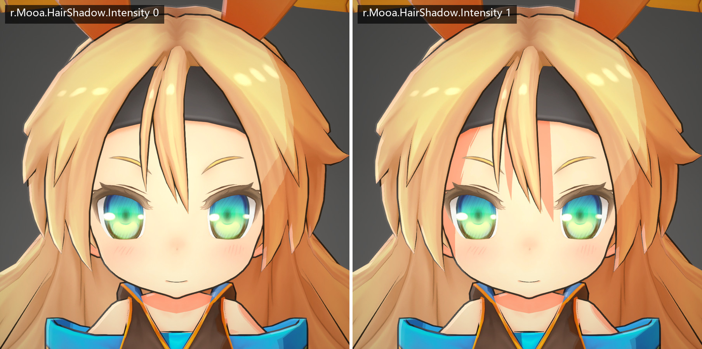

*5.7 实拍，同一魔改引擎内调参：`r.Mooa.HairShadow.Intensity` 为 0（左）和 1（右）。开启后刘海在额头和脸侧留下了与发梢轮廓一致的阴影色块。*

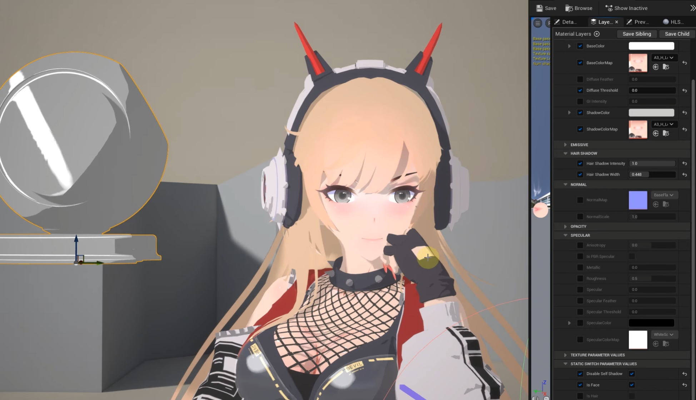

*VRM 角色的脸部特写。右侧材质层面板里的 Hair Shadow Intensity、Hair Shadow Width、Is Face、Disable Self Shadow 对应这一节的头发阴影和 4.7 节的自阴影开关。（README 截图，早期版本）*

**(3) SDF 面部阴影**

```hlsl
// Shaders/Private/ToonShadingModel.ush:161
float3 FaceForwardDir = GBuffer.WorldTangent;
float LightAngle01 = FastACos(dot(FaceForwardDir, L)) * PI_INV; // 0 - 180 => 0 - 1
float RampUVOffsetByLightAngle = 1.0f - clamp(LightAngle01, 1e-6, 1.0f - 1e-6) - 0.5f;

bool bLightAtRight = (FaceForwardDir.x * L.y - FaceForwardDir.y * L.x) >= 0; // cross(FaceForwardDir, L).z >= 0; 
float shadowSdf = bLightAtRight ? ToonGBuffer.FacialShadowSdfRight : ToonGBuffer.FacialShadowSdfLeft;

FacialShadowGradient = LinearToDotProductSpace(RampUVOffsetByLightAngle + shadowSdf + DiffuseColorRampUVOffset);
```

- 这是 `ApplyDistanceFieldFacialShadow` 的主体，只在 `ShadingFeatureID` 为 SDF 面部阴影、并且后处理体积对当前光源类型开启了该功能时执行。
- **脸的朝向从切线来**：面部材质把"脸的正前方"写进 Tangent 引脚（4.9 节会讲 Toon 的切线为什么可以直接当世界向量用），这里从 GBuffer 的 `WorldTangent` 读出。
- **光照角度**：脸朝向和光方向的夹角，0 到 180 度映射到 0 到 1。
- **左右判断**：两个向量叉积的 Z 分量的符号说明光在脸的左边还是右边，据此选用右脸或左脸的 SDF 值。左右两个值都由材质提供，引擎只负责二选一。
- **合成梯度**：角度项加上 SDF 值，换算到余弦空间后**替换**掉基于法线的 `ShadowGradient`。也就是说脸上的明暗交界线完全由手绘的阈值图决定，不再受面部法线影响。

SDF 阴影阈值图需要离线生成。示例工程的 `Art/DistanceFieldFacialShadowSamples` 附带了一组输入遮罩和输出结果：

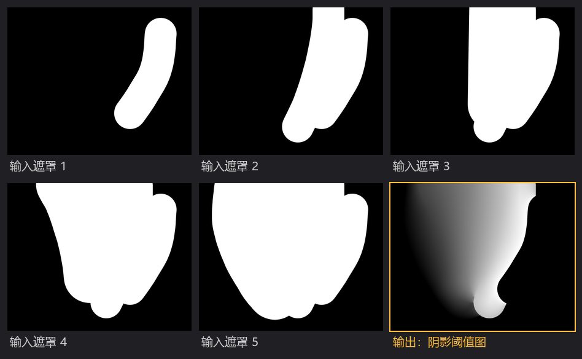

*五张手绘的阴影遮罩（光照角度逐步变化）插值成一张阈值图，运行时用一次比较就能还原任意角度的阴影形状。图片由示例工程 Art 目录下的原始文件裁剪拼合；生成工具是 akasaki1211 的 sdf_shadow_threshold_map。*

这一项没有实拍对比图：示例工程里的 UnityChan 和 VRM 角色的面部材质都没有启用 Distance Field Facial Shadow，开关前后画面没有差别。

**(4) 高光：GGX、Ramp 风格化、Kajiya-Kay 三选一**

```hlsl
// Shaders/Private/ToonShadingModel.ush:364
BRANCH if (ToonGBuffer.ShadingFeatureID == MOOA_SHADING_FEATURE_ID_PBR_SPECULAR)
{
    // 此分支调用引擎原生的 SpecularGGX 或 RectGGXApproxLTC，代码省略
}
else
{
    float MaxSpecularValue;
    float SpecularColorRampU = GetSpecularColorRampUAndMaxSpecularValue(GBuffer, Context, N, H,
        /*out*/ MaxSpecularValue);
    float SpecularColorRampUVOffset = (ToonGBuffer.SpecularColorRampUVOffset * 2.0f - 1.0f) * View.MooaSpecularColorRampUVOffsetMaxRange;
    half3 SpecularColor = SampleGlobalRamp(View.MooaGlobalSpecularColorRampAtlas, SpecularColorRampU + SpecularColorRampUVOffset, ToonGBuffer.SpecularColorRampIndex,  View.MooaGlobalSpecularColorRampAtlasHeight).rgb;

    Lighting.Specular = GBuffer.SpecularColor * ToonGBuffer.SpecularColor * MaxSpecularValue * SpecularColor * LightColorAndAttenuation * Shadow.SurfaceShadow;
}
```

- `ShadingFeatureID` 为 PBR 高光时，直接调用引擎原生的 GGX，支持各向异性和矩形光，和 Default Lit 的高光一致。
- 否则走风格化高光：先算一个 0 到 1 的"高光梯度"作为 Specular Ramp 的 U 坐标，采样得到颜色，再乘以一个"峰值亮度" `MaxSpecularValue`。高光的**形状和边缘硬度由 Ramp 决定**，**亮度量级向 PBR 看齐**。

梯度和峰值怎么来的：

```hlsl
// Shaders/Private/ToonShadingModel.ush:179
BRANCH if (GBuffer.MooaToonContext.ToonGBuffer.ShadingFeatureID == MOOA_SHADING_FEATURE_ID_KAJIYA_HAIR_SPECULAR)
{
    MaxSpecularValue = PI;
    
    // Kajiya Kay Hair Specular
    float ToH = 1.0f - abs(dot(GBuffer.WorldTangent, H));

    // As a rule of thumb, the binary specular size is approximated to PBR specular, test in L_LookDev_Lighting
    const float SpecularGradientPowMin = 2.0f;
    const float SpecularGradientPowMax = 128.0f;
    float SpecularGradientPow = (OneMinusRoughness2 * OneMinusRoughness2) * (SpecularGradientPowMax - SpecularGradientPowMin) + SpecularGradientPowMin;
    return FastPow01(ToH, SpecularGradientPow);
}
else
{
    // The MaxSpecularValue is calculated using special values, modified from SpecularGGX().
    {
        float a2 = Pow4(GBuffer.Roughness);
        float D = rcp(a2 * PI); // D_GGXaniso(ax, ay, 1, 0, 0);
        float Vis = 0.25f; // Vis_SmithJointAniso(ax, ay, 1, 1, 0, 0, 0, 0);
        float F = 1; // F_Schlick( GBuffer.SpecularColor, Context.VoH );
        
        // No Specular when Roughness == 1 & Metallic == 0
        float DefaultStateCorrection = 1.0f - Pow2(GBuffer.Roughness * (1.0 - GBuffer.Metallic)); 
        MaxSpecularValue = min(16.0f /* Max Specular Intensity */, D * Vis * F * DefaultStateCorrection);
    }
    // 以下是梯度部分的节选
    float3 V = float3(saturate(-GBuffer.Anisotropy) * Context.XoH, saturate(GBuffer.Anisotropy) * Context.YoH, (1 - abs(GBuffer.Anisotropy)) * (1 - Context.NoH));
    float SpecularGradient = saturate(1.0f - sqrt(sqrt(dot(V, V)))); 
    float PowCurveFromRoughness = saturate(exp(-25.0f * GBuffer.Roughness) * 0.7f + 0.3f) * OneMinusRoughness2;
    PowCurveFromRoughness *= Pow2(1.0f - 2.0f * GBuffer.Roughness) + 0.5f;
    float SpecularGradientPow = 1.0f /* Pow Min (Roughness 1) */ + PowCurveFromRoughness * 40.0f /* Pow Max (Roughness 0) */;
    return FastPow01(SpecularGradient, SpecularGradientPow);
}
```

这段代码和下面边缘光的代码块都省略了源码中被注释掉的试验代码和部分英文注释。

- **Kajiya-Kay 分支**（头发）：梯度来自切线与半角向量的点积，沿发丝方向形成一条高光带。幂次随粗糙度在 2 到 128 之间变化，粗糙度越低高光带越窄。
- **默认分支的峰值**：把 GGX 在高光正中心（N·H = 1）的值代进去，D 项是 `1 / (a² · π)`，可见性项和菲涅尔项取常数，上限 16。这样同样的粗糙度下，卡通高光最亮处和 PBR 高光最亮处差不多亮，材质在 PBR 和 Toon 之间切换时不需要重新调强度。`DefaultStateCorrection` 让"粗糙度 1、非金属"的默认材质没有高光。
- **默认分支的梯度**：由 `1 - N·H` 构造，各向异性不为 0 时混入切线和副切线方向的分量，所以高光可以被拉长。后面那组带 `exp` 的曲线是按粗糙度拟合的经验公式，源码注释说明是在 `L_LookDev_Lighting` 关卡里对照 PBR 高光的范围调出来的。

**(5) 边缘光：逐光源的屏幕空间深度测试**

```hlsl
// Shaders/Private/ToonShadingModel.ush:239
BRANCH if (ToonGBuffer.RimLightIntensity > 0 && ToonGBuffer.RimLightWidth > 0)
{
    const float MaxRimLightWidth = 3.0f * View.MooaRimLightMaxWidth;
    const float DepthFadeDistance = View.MooaRimLightDepthTestFadeDistance;
    const float RimLightDepthThreshold = View.MooaRimLightDepthTestThreshold;
    const float RimLightWidth = Pow2(ToonGBuffer.RimLightWidth);
    const float RimLightIntensity = ToonGBuffer.RimLightIntensity;

    float2 ViewportUVOffset = L_ViewportOffsetBase * MaxRimLightWidth * RimLightWidth;
    float2 TargetBufferUV = ViewportUVToBufferUV(saturate(ViewportUV + ViewportUVOffset));

    float NewDepth = 0;
#if MATERIALBLENDING_TRANSLUCENT || MATERIALBLENDING_ADDITIVE || MATERIALBLENDING_MODULATE
    float SingleLayerDeviceZ = Texture2DSampleLevel( TranslucentBasePass.SceneDepth, GlobalPointClampedSampler, TargetBufferUV, 0).r;
    NewDepth = ConvertFromDeviceZ(SingleLayerDeviceZ);
#elif SHADING_PATH_DEFERRED
    NewDepth = CalcSceneDepth(TargetBufferUV);
#endif
    float DepthFade = saturate((NewDepth - GBuffer.Depth - RimLightDepthThreshold)
        / max(1e-5, DepthFadeDistance));

    RimLightColor = DepthFade * ComputeF0(RimLightIntensity, GBuffer.BaseColor, GBuffer.Metallic);
}
// 以下在 396 行，ToonBxDF 的末尾
float3 RimLight = GetScreenSpaceDepthTestRimlightColor(GBuffer, ToonGBuffer, MooaToonContext.ViewportUV, L_ViewportOffsetBase) * LightColorAndAttenuation * Shadow.SurfaceShadow;
ColorSaturationPowerAndScale(RimLight, View.MooaRimLightSaturationScale, View.MooaRimLightIntensity);
Lighting.Specular += RimLight;
```

- 和头发阴影是同一个思路，方向相反：朝光源方向偏移后采样深度，如果那里**明显更远**，说明当前像素处在朝向光源的轮廓边缘，应该亮。
- 偏移量由材质的 Rim Light Width（平方后使用，让小数值更好调）和全局的 `r.Mooa.RimLight.MaxWidth` 共同决定。
- `#if` 的第一个分支处理半透明材质：前向着色时读不到 GBuffer，改读半透明 pass 自己的场景深度，所以半透明的 Toon 材质也有边缘光。
- 颜色用引擎计算 F0 的函数得到：非金属是与强度成正比的灰度，金属带上底色。回到 `ToonBxDF` 后乘以光色和阴影，再用后处理参数调饱和度和整体强度，最后加到高光项里。
- 因为这段代码在 BxDF 内部，**每个光源都会各算一次**：边缘光出现在朝向各自光源的一侧，颜色跟随光源，被阴影挡住的地方没有。这是后处理描边式的"全局边缘光"做不到的。

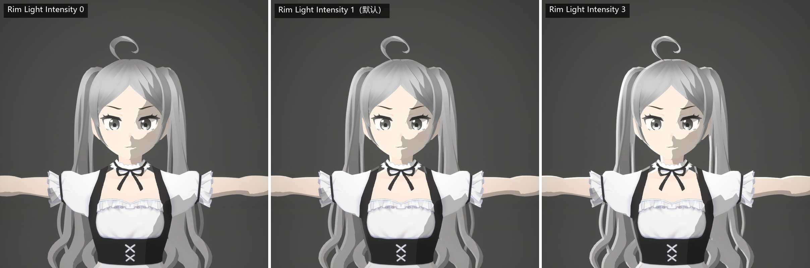

*5.7 实拍，同一魔改引擎内调参：`L_LookDev_VRM` 关卡的 VRM 角色，后处理体积的 Rim Light Intensity 依次为 0、1（默认）、3。朝光一侧的头发、手臂和袖口轮廓上的亮边逐级变强。这里换用 VRM 角色，是因为 UnityChan 材质的 Rim Light Width 和 Intensity 都是 0。*

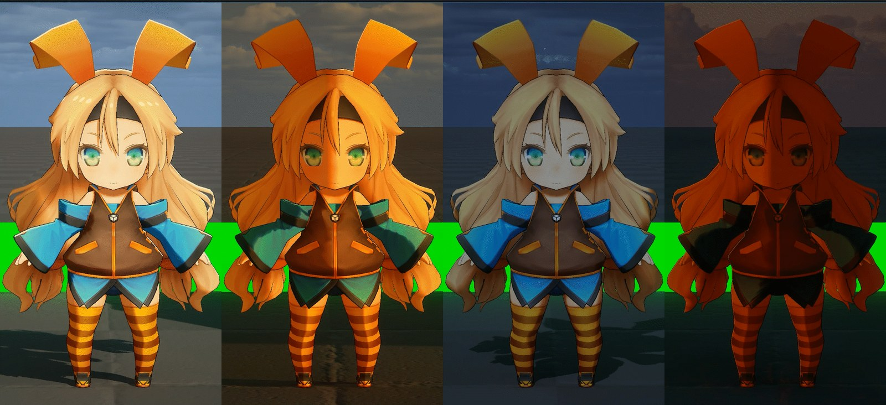

*README 动图中抽取的四帧：同一套材质在不同的太阳角度和光色下的表现。光色、阴影方向、地面投影都来自引擎原生灯光。*

**好处**：明暗交界线、阴影色、高光形状、边缘光全部变成美术可控的量，同时每一项都是"逐光源"计算的，场景里有几盏灯就算几次，点光、聚光、矩形光和平行光一视同仁。

### 4.5 接入延迟光照

| 文件 | 在引擎中的职责 | 改动 |
|---|---|---|
| `Shaders/Private/DeferredLightingCommon.ush` | 延迟光照核心函数 `GetDynamicLighting` | 见下 |
| `Shaders/Private/DeferredLightPixelShaders.usf` | 每个光源的全屏或光体积像素着色器入口 | 定义 `MOOA_TOON_DEFERRED_LIGHTING`，传入光源类型，Toon 用独立曝光 |
| `Shaders/Private/ToonShadingCommon.ush`（新增） | Toon 公共定义 | `FMooaToonContext` 结构和一组 `SetMooaToonContext_*` 宏 |

原版逻辑是"完全在阴影里的像素直接跳过光照计算"，并且在 BxDF 外面统一乘上阴影和光色。这两点对卡通渲染都不成立：阴影里的像素要显示阴影色，阴影还要参与 Ramp 采样。

**关键代码与含义**

**(1) 一个随 GBuffer 传递的上下文**

```hlsl
// Shaders/Private/ToonShadingCommon.ush:398
struct FMooaToonContext
{
    FToonGBufferData ToonGBuffer;
    float4 EncodedToonBufferA; // Output to ToonBufferA from Base Pass
    uint LightType;
    float3 LightColor;
    bool IsEditorPreviewWorldType;
    float Exposure;
    uint2 PixelPos; // SVPos.xy
    float2 BufferUV;
    float2 ViewportUV;
};
```

- `ToonBxDF` 的函数签名是引擎固定的，只有 `GBuffer, N, V, AreaLight, Shadow` 五个参数，没有地方传"光源类型""光色""像素坐标"。MooaToon 的办法是把这些额外信息放进 `FGBufferData` 的成员 `MooaToonContext` 里，跟着 GBuffer 结构一起进入 BxDF。
- 这样做不需要改 `IntegrateBxDF` 和其他十几个着色模型的函数签名，合并引擎更新时冲突最小。

**(2) 光照主函数里的三处改动**

```diff
 // Shaders/Private/DeferredLightingCommon.ush:405
-		if( Shadow.SurfaceShadow + Shadow.TransmissionShadow > 0 )
+		if( (Shadow.SurfaceShadow + Shadow.TransmissionShadow > 0) || GBuffer.ShadingModelID == SHADINGMODELID_TOON)// Mooa Toon Shading
+			// Mooa GBuffer
+			SetMooaToonContext_LightType(GBuffer, LightData);
+			SetMooaToonContext_LightColor(GBuffer, MaskedLightColor);
+			SetMooaToonContext_PixelPosAndUVs(GBuffer, SVPos);
+			// Mooa End
+			// Mooa Toon Shading
+			BRANCH
+			if (GBuffer.ShadingModelID == SHADINGMODELID_TOON)
+			{
+				Shadow.SurfaceShadow = 1;
+				MaskedLightColor = 1;
+			}
+			// Mooa End
            LightAccumulator_AddSplit( LightAccumulator, Lighting.Diffuse, Lighting.Specular, Lighting.Diffuse, MaskedLightColor * Shadow.SurfaceShadow, bNeedsSeparateSubsurfaceLightAccumulation );
```

这是 `GetDynamicLighting` 里三处改动的合并展示（分别在约 405、430、465 行）：

- **第一处**：原版对完全处于阴影中的像素直接跳过整段光照计算，这是一个性能优化。Toon 像素加了例外，即使阴影值为 0 也要进入，因为要在里面算阴影色。
- **第二处**：调用 BxDF 之前，用三个宏把光源类型、光色、像素坐标和 UV 填进上下文。`SetMooaToonContext_LightType` 根据 `LightData` 里的 `bRectLight`、`bSpotLight`、`bRadialLight` 等标志判断出平行光、点光、聚光、矩形光四种类型，后处理体积里"按光源类型分别设置"的那些参数就靠它区分。
- **第三处**：BxDF 返回之后，原版会在累加时统一乘上 `MaskedLightColor * Shadow.SurfaceShadow`。`ToonBxDF` 内部已经自己乘过光色、处理过阴影，所以这里把两个乘数都置为 1，避免重复计算。

**(3) 光源着色器入口：标记与独立曝光**

```hlsl
// Shaders/Private/DeferredLightPixelShaders.usf:7
// Mooa Toon Shading Model
#define MOOA_TOON_DEFERRED_LIGHTING
// 以下在 408 行，输出颜色之前
// Mooa Toon Deferred Shading
BRANCH
if(ScreenSpaceData.GBuffer.ShadingModelID == SHADINGMODELID_TOON)
{
    OutColor.rgba *= ScreenSpaceData.GBuffer.MooaToonContext.Exposure;
}
else
{
    OutColor.rgba *= GetExposure();
}
```

- 文件开头的 `#define` 给这个编译单元打上"我是延迟光照 pass"的标记。`ToonShadingModel.ush` 会被很多 shader 包含（光追、半透明前向着色等），其中只有延迟光照 pass 能安全地读取邻近像素的 GBuffer，4.4 节的头发阴影就用这个宏做守卫。
- 结尾处原版统一乘 `GetExposure()`。Toon 像素改乘上下文里的 `Exposure`，它在 `InitMooaToonContext` 里被设为 `View.PreExposure * View.MooaExposureScale`，也就是在场景曝光的基础上多乘一个后处理体积里的 Exposure Scale。

**好处**：`ToonBxDF` 拿到了完整的阴影值和光色，可以自己决定怎么用，而其他着色模型的行为完全不变。

### 4.6 间接光、反射与曝光

卡通角色放进 Lumen 场景后常见的问题是：GI 带有方向性，脸上会出现脏的明暗；环境反射让皮肤像塑料；自动曝光把角色压暗或冲白。

| 文件 | 在引擎中的职责 | 改动 |
|---|---|---|
| `Shaders/Private/DiffuseIndirectComposite.usf` | 把间接漫反射、反射和 AO 合成到场景颜色（Lumen 路径） | Toon 像素走独立分支 |
| `Shaders/Private/ReflectionEnvironmentPixelShader.usf` | 反射环境与天光合成（非 Lumen 路径） | 同样的控制，作为回退 |
| `Shaders/Private/ReflectionEnvironmentShared.ush` | 天光球谐工具函数 | 前向着色的方向性控制 |
| `Shaders/Private/Lumen/LumenScreenProbeGather.usf` | Lumen 屏幕探针的最终收集 | Toon 像素的法线可向相机方向压平 |
| `Shaders/Private/RayTracing/CompositeSkyLightPS.usf` | 光追天光合成 | 接入 Toon |
| `Shaders/Private/BasePassPixelShader.usf` | 前向着色的间接光 | 半透明 Toon 材质的 GI 强度与曝光 |

**关键代码与含义**

**(1) Lumen 合成阶段的 Toon 分支**

```hlsl
// Shaders/Private/DiffuseIndirectComposite.usf:635
// Mooa Indirect Lighting (Lumen)
if (Material.GBufferData.ShadingModelID == SHADINGMODELID_TOON)
{
    float3 SHDiffuseAverage = GetSkySHDiffuse(0.0f) * View.SkyLightColor.rgb * View.PreExposure;
    float3 LumenGiDiffuse = IndirectLighting.Diffuse;
    FToonGBufferData ToonGBuffer = Material.GBufferData.MooaToonContext.ToonGBuffer;

    // Diffuse
    float3 MixedGIColor = lerp(SHDiffuseAverage * Material.GBufferData.DiffuseColor, LumenGiDiffuse, View.MooaGlobalIlluminationDirectionality);
    float3 IndirectDiffuseColor = lerp(
        MixedGIColor * View.MooaGlobalIlluminationColor.rgb,
        View.MooaGlobalIlluminationColor.rgb * Material.GBufferData.DiffuseColor,
        View.MooaGlobalIlluminationColor.a)
    * View.MooaGlobalIlluminationIntensity;

    // Specular
    float3 IndirectSpecularColor = IndirectLighting.Specular * Pow2(ToonGBuffer.ReflectionIntensity);

    OutAddColor.rgb = IndirectDiffuseColor + IndirectSpecularColor;
    OutAddColor.rgb *= View.MooaExposureScale;
}
```

这个 pass 负责把 Lumen 算好的间接漫反射和反射加到场景颜色上。Toon 像素不走原版的累加逻辑，而是自己组合：

- **`SHDiffuseAverage`**：用零向量作为法线去查天光球谐，方向相关的项全部为 0，只剩常数项，得到的是天光在所有方向上的平均颜色。
- **GI Directionality**：在"平均天光色乘以底色"和"Lumen 的真实 GI"之间插值。设为 0 时角色各处接收同一个环境色，没有明暗起伏，干净；设为 1 时与原版一致。因为平均色来自天光，这个参数只在场景有天光时有意义，没有天光的室内应保持为 1（`Scene.h` 里该参数的注释也是这么写的）。
- **GI Color**：RGB 给 GI 调色；alpha 控制混合方式，0 是把颜色乘到 GI 上，1 是用"指定颜色乘以底色"完全替换 GI。
- **GI Intensity**：整体强度。构造函数里的默认值是 0，也就是默认不接收 GI，需要在后处理体积里打开。
- **Reflection Intensity**：每材质的反射强度，平方后乘到间接高光上。皮肤可以设为 0 彻底去掉环境反射，金属饰品保留。
- **最后一行**：间接光也乘 Exposure Scale，和 4.5 节直接光的独立曝光保持一致。

同一个文件的约 395 行还有一处针对屏幕空间 AO 的改动：

```hlsl
// Shaders/Private/DiffuseIndirectComposite.usf:395
// Mooa Indirect Lighting
BRANCH if (Material.ShadingID == SHADINGMODELID_TOON)
    DynamicAmbientOcclusion = lerp(1, DynamicAmbientOcclusion, saturate(View.MooaDynamicAOIntensity));
```

- `r.Mooa.AmbientOcclusion.DynamicAOIntensity` 默认 0，所以 Toon 像素默认不受屏幕空间 AO 影响，腋下、领口不会出现灰色的脏边。需要时可以调高。

**(2) 在 Lumen 采样之前压平法线**

```hlsl
// Shaders/Private/Lumen/LumenScreenProbeGather.usf:1151
// Mooa Indirect Lighting
// https://zhuanlan.zhihu.com/p/25839790454
{
    float3 CanmeraVector = GetCameraVectorFromWorldPosition(WorldPosition);
    BRANCH if (Material.ShadingID == SHADINGMODELID_TOON)
    {
        Material.WorldNormal = normalize(lerp(WorldNormal, -CanmeraVector, saturate(View.MooaGlobalIlluminationLumenNormalFlatten)));
    }
}
```

- Lumen 的屏幕探针按像素法线的朝向收集间接光。这里在收集之前，把 Toon 像素的法线朝相机方向插值。
- 参数 GI Lumen Normal Flatten 为 1 时，整个角色的法线都指向相机，相当于一张正对镜头的平面，GI 在角色表面完全没有起伏；为 0 时不改动。
- 和 GI Directionality 的区别：后者混入的是天光平均色，丢掉了 Lumen 的反弹光信息；压平法线仍然用 Lumen 的结果，只是去掉了随法线变化的部分，室内也能用。

**(3) 前向着色的对应处理**

```hlsl
// Shaders/Private/ReflectionEnvironmentShared.ush:86
float3 GetSkySHDiffuse(float3 Normal)
{
    // Mooa Indirect Lighting (Transparent Forward Shading)
#if MATERIAL_SHADINGMODEL_TOON
    Normal *= View.MooaGlobalIlluminationDirectionality;
#endif
```

- 半透明材质不经过延迟合成，天光是在材质自己的 shader 里算的。这里把法线乘以方向性参数：为 0 时法线变成零向量，查到的就是平均天光色，效果与 (1) 的延迟路径对应。
- `BasePassPixelShader.usf` 里还有两处同类改动：约 1658 行给 Toon 的间接漫反射乘 `View.MooaGlobalIlluminationIntensity`，约 2473 行给前向着色的预曝光乘 `View.MooaExposureScale`。这样半透明的 Toon 材质（例如刘海的透明部分）和不透明部分对这组参数的响应一致。

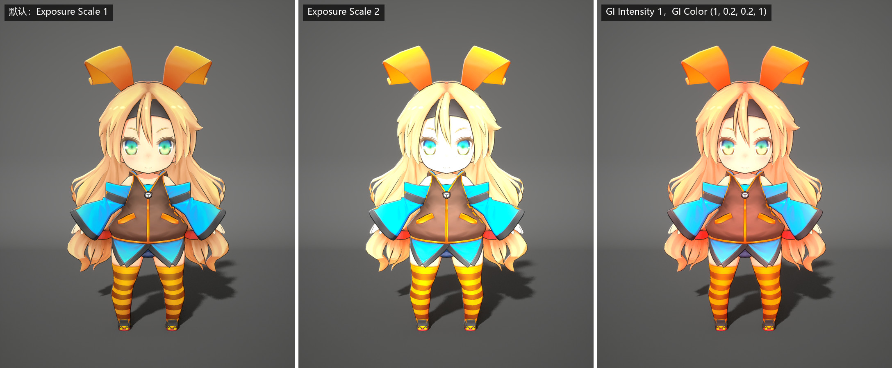

*5.7 实拍，同一魔改引擎内调参。左：默认。中：后处理体积的 Exposure Scale 设为 2，只有角色变亮，背景和地面不变。右：GI Intensity 设为 1、GI Color 设为 (1, 0.2, 0.2, 1)，角色整体被染上红色，背景同样不受影响。两项都只作用于 Toon 像素。*

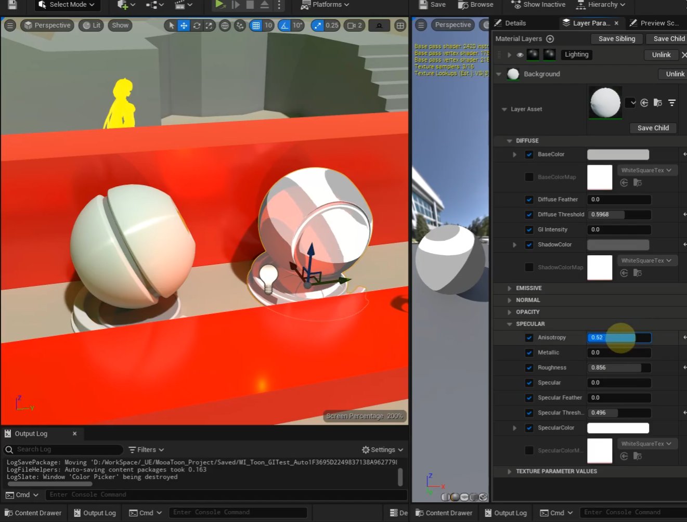

*强烈红色反弹光环境下的 Toon 材质球。右侧可见 GI Intensity、Anisotropy 等参数。GI 是否染到角色身上、染多少，由上面这组参数决定。（README 截图，早期版本）*

**好处**：角色可以"站在" Lumen 场景里被环境影响，但影响的程度和方式由美术决定，不需要为角色单独打一套灯或关掉 GI。

### 4.7 阴影：三种去自阴影的手段

卡通角色身上的自阴影（下巴投在脖子上、刘海投在额头上）往往是不想要的，但角色又必须在地面上投影、也要接受场景的投影。

**(1) 光追阴影 + Stencil：精确控制**

| 文件 | 在引擎中的职责 | 改动 |
|---|---|---|
| `Shaders/Private/RayTracing/RayTracingOcclusionRGS.usf` | 光追阴影的射线生成着色器 | 识别 Toon 像素，带着 Stencil 发射阴影射线 |
| `Shaders/Private/RayTracing/RayTracingMaterialHitShaders.usf` | 材质的最近命中和任意命中着色器 | Toon 不透明材质也执行任意命中，在里面判断是否忽略 |
| `Shaders/Private/RayTracing/RayTracingCommon.ush` | 光追负载结构与发射射线的工具函数 | 负载加入 `FMooaCustomPayload` |
| `Source/Runtime/Renderer/Private/RayTracing/RayTracingMaterialHitShaders.cpp` | 决定为每个材质编译哪些命中着色器 | Toon 材质编译任意命中着色器 |
| `Source/Runtime/RenderCore/Private/BuiltInRayTracingShaders.cpp` | 内建光追着色器与负载大小 | 负载上限由 64 字节改为 68 字节 |
| `Source/Runtime/Engine/Private/Materials/Material.cpp`、`Shaders/Private/MaterialTemplate.ush` | 材质属性与模板 | Toon 材质提供 Stencil 和标志位 |

光追阴影的流程是：射线生成着色器从每个屏幕像素朝光源发射一条射线；射线碰到几何体时，如果该材质有任意命中着色器（Any Hit Shader），就执行它来决定"这次命中算不算数"。MooaToon 利用的正是这个决定权。

先看随射线携带的数据：

```hlsl
// Shaders/Private/ToonShadingCommon.ush:462
/* MP_CustomData0(ClearCoat) = unused(25)	Stencil(5)	DisableCastShadowOnToon(1)	DisableSelfShadow(1) */
struct FMooaCustomPayload
{
    // add to RAY_TRACING_MAX_ALLOWED_PAYLOAD_SIZE
    uint MooaCustomData;					// 4 bytes
    bool IsDisableSelfShadow()				{ return MooaCustomData & (1 << 0); }
    bool IsDisableCastShadowOnToon()		{ return MooaCustomData & (1 << 1); }
    uint GetStencil()						{ return (MooaCustomData >> 2) & GetBitsMaxValue(5); }
    void SetStencil(uint Stencil)			{ MooaCustomData |= ((Stencil & GetBitsMaxValue(5)) << 2); }
};
```

- 一个 32 bit 整数：最低位是"关闭自阴影"，第二位是"不在其他 Toon 表面上投影"，再往上 5 bit 是 Stencil。
- 这个结构被加进了引擎的光追负载 `FPackedMaterialClosestHitPayload`（`RayTracingCommon.ush:873`）。负载变大 4 字节，所以 `BuiltInRayTracingShaders.cpp:26` 里允许的最大负载从 `64u` 改成了 `68u`。
- 材质侧通过 `CustomData0` 引脚输出这个整数（4.3 节点亮这个引脚就是为了这里）。

射线生成着色器里，先识别 Toon 像素，再带上 Stencil 发射：

```hlsl
// Shaders/Private/RayTracing/RayTracingOcclusionRGS.usf:778
// Mooa Ray Tracing Shadow
{
    // UE 5.1 BUG: ShadingModelID is always DefaultLit
    // ShadingParameters.bIsToon = GBufferData.ShadingModelID == SHADINGMODELID_TOON;
    
    float4 ToonBufferA = ToonBufferATexture.Load(int3(PixelCoord, 0));
    ShadingParameters.bIsToon = any(ToonBufferA != 0);
    if (ShadingParameters.bIsToon)
    {
        GBufferData.ShadingModelID = SHADINGMODELID_TOON;
        GBufferData.MooaToonContext.EncodedToonBufferA = ToonBufferA;
        GBufferData.MooaToonContext.ToonGBuffer = DecodeToonGBufferDataFromMRT(GBufferData.MooaToonContext.EncodedToonBufferA, GBufferData.CustomData, GBufferData.Metallic, GBufferData.Anisotropy);
    }
    ShadingParameters.GBufferData = GBufferData;
}
// 以下在 471 行，发射阴影射线处
// Mooa Ray Tracing Shadow
FMooaCustomPayload MooaCustomPayload = (FMooaCustomPayload)0;
uint HitShadingModelID = SHADINGMODELID_TOON;
FToonGBufferData ToonGBuffer = ShadingDesc.GBufferData.MooaToonContext.ToonGBuffer;
if (ShadingDesc.bIsToon)
{
    RayFlagsForOpaque = 0;
    MooaCustomPayload.SetStencil(ToonGBuffer.Stencil);
#if !SUBSTRATE_ENABLED
    MinimalPayload = MooaTraceVisibilityRay(TLAS, RayFlags | RayFlagsForOpaque, RaytracingMask, Ray, HitShadingModelID, MooaCustomPayload);
#endif
}
```

- **识别方式**：按源码注释，这个 pass 里读到的 `ShadingModelID` 总是 Default Lit，所以改用"`ToonBufferA` 是否全 0"来判断当前像素是不是 Toon。非 Toon 材质不写这张 RT，它保持清零状态。这个判断有一个隐含前提，第 6 节会提到。
- **`RayFlagsForOpaque = 0`**：原版对不透明几何体会设置"跳过任意命中着色器"的射线标志来加速。Toon 像素发出的射线清掉这个标志，否则下面的任意命中逻辑根本不会被调用。
- **`MooaTraceVisibilityRay`**（`RayTracingCommon.ush:1253`）是新增的发射函数，把"出发点是 Toon"和出发点的 Stencil 写进负载再发射。

对应地，C++ 侧要保证 Toon 材质确实编译了任意命中着色器：

```cpp
// Source/Runtime/Renderer/Private/RayTracing/RayTracingMaterialHitShaders.cpp:169
const bool bWantAnyHitShader = CVarCompileMaterialAHS.Get(Parameters.Platform) != 0 && 
    (RTNeedsAnyHitShader(Parameters.MaterialParameters.BlendMode) || Parameters.MaterialParameters.ShadingModels.HasShadingModel(MSM_Toon)); // Mooa Ray Tracing Shadow
```

```diff
 // Shaders/Private/RayTracing/RayTracingMaterialHitShaders.usf:817
-#if MATERIALBLENDING_SOLID
+#if MATERIALBLENDING_SOLID && !MATERIAL_SHADINGMODEL_TOON // Mooa Ray Tracing Shadow
 // 以下在 825 行，894 行还有一处相同的改动
-#if MATERIALBLENDING_MASKED
+#if MATERIALBLENDING_MASKED || MATERIAL_SHADINGMODEL_TOON // Mooa Ray Tracing Shadow
```

- 原版只给 Masked 和半透明材质编译任意命中着色器，不透明材质不需要。C++ 那一行给 Toon 开了例外。
- shader 里的两行 `#if` 让不透明的 Toon 材质不再走"不透明，直接返回"的捷径，而是走 Masked 材质的路径，这样它也能用 OpacityMask 引脚在阴影里镂空。

最后是任意命中着色器里的判断：

```hlsl
// Shaders/Private/RayTracing/RayTracingMaterialHitShaders.usf:807
// Mooa Ray Tracing Shadow
bool IsHitToonShadingModel = false;
#if !SUBSTRATE_ENABLED 
    #if MATERIAL_SHADINGMODEL_TOON
        IsHitToonShadingModel = true;
    #endif
#endif
// Mooa End
// 以下在 1030 行，任意命中着色器的末尾；省略了源码中被注释掉的几行试验代码
// Mooa Ray Tracing Shadow
#if !SUBSTRATE_ENABLED && MATERIAL_SHADINGMODEL_TOON
    FMooaCustomPayload HitMooaCustomPayload = (FMooaCustomPayload)0;
    HitMooaCustomPayload.MooaCustomData = uint(GetMaterialCustomData0(PixelMaterialInputs));

    // if RayOrigin and HitPoint both Toon Material
    if (PackedPayload.GetShadingModelID() == SHADINGMODELID_TOON && IsHitToonShadingModel)
    {
        // Disable Self Shadow
        if (HitMooaCustomPayload.IsDisableSelfShadow() &&
            PackedPayload.MooaCustomPayload.GetStencil() == HitMooaCustomPayload.GetStencil())
            IgnoreHit();
        
        // Disable Cast Shadow on Toon Material
        if (HitMooaCustomPayload.IsDisableCastShadowOnToon() &&
            PackedPayload.MooaCustomPayload.GetStencil() != HitMooaCustomPayload.GetStencil())
            IgnoreHit();
    }
#endif // !SUBSTRATE_ENABLED && MATERIAL_SHADINGMODEL_TOON
// Mooa End
```

- `IsHitToonShadingModel` 在函数开头由编译期的宏决定：这份任意命中着色器是为 Toon 材质编译的，它就是 `true`。
- `PackedPayload` 里是**射线出发点**的信息（着色模型和 Stencil），`HitMooaCustomPayload` 是**被命中表面**的材质当场算出来的信息。
- 两边都是 Toon 时才判断。**Stencil 相同**且命中表面勾了"关闭自阴影"：`IgnoreHit()`，射线穿过去，等于同一个部位不给自己投影。**Stencil 不同**且命中表面勾了"不在 Toon 上投影"：同样忽略，等于这个部件不给角色的其他部位投影。
- 射线出发点不是 Toon（例如地面）时两个条件都不成立，角色照常在地面上投影。

Stencil 可以用 ID 贴图按部位划分，一个角色最多 32 组。

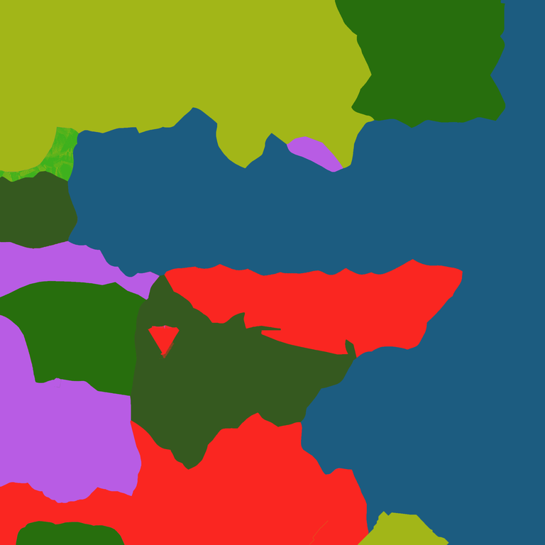

*示例工程 `Art/Models/NewTextures` 里 UnityChan 的 ID 贴图：每种颜色是一个区域，这类贴图可以用来给不同部位分配不同的 Stencil。*

**(2) Shadow Bias：不开光追时的近似方案**

后处理体积的 Shadow Bias（`View.MooaShadowBias`）在阴影比较时把 Toon 像素沿光方向推远一段距离，这段距离以内的遮挡都被忽略。四种阴影技术各有一处改动：

```hlsl
// Shaders/Private/VirtualShadowMaps/VirtualShadowMapProjection.usf:264
// Mooa Shadow: VSM, Directional Light
#if DIRECTIONAL_LIGHT
    FGBufferData GBufferData = GetGBufferDataUint(PixelPos);
    if (GBufferData.ShadingModelID == SHADINGMODELID_TOON)
    {
        SMRTRayOffset += View.MooaShadowBias * 2;
    }
#endif
```

```hlsl
// Shaders/Private/VirtualShadowMaps/VirtualShadowMapProjectionSpot.ush:396
// Mooa Shadow: VSM, Spot/Point/Rect Light
FGBufferData GBufferData = GetGBufferDataUint(PixelPos);
if (GBufferData.ShadingModelID == SHADINGMODELID_TOON)
{
    float4 ShadowUVz = mul(float4(RayStart, 1.0f), GetVirtualShadowMapProjectionData(VirtualShadowMapHandle).TranslatedWorldToShadowUVMatrix);
    float MooaShadowBias = -(View.MooaShadowBias * 0.01f * 0.5f / ShadowUVz.w);
    if ( LightType == LIGHT_TYPE_SPOT )
        MooaShadowBias *= -0.5f;
    DepthBias += MooaShadowBias;
}
```

```hlsl
// Shaders/Private/ShadowProjectionPixelShader.usf:258
// Mooa Shadow: Shadow Map, Directional/Spot Light
#if SHADING_PATH_DEFERRED && !FORWARD_SHADING && !SUBPIXEL_SHADOW && !SUBSTRATE_ENABLED
{
    FGBufferData GBufferData = GetGBufferData(ScreenUV);
    if (GBufferData.ShadingModelID == SHADINGMODELID_TOON && View.MooaShadowBias > 0)
    {
        BRANCH if (bIsDirectional)
            Settings.TransitionScale = max(0, SoftTransitionScale.z / max(1, View.MooaShadowBias));
        else // Spot Light
            Settings.TransitionScale = max(0, SoftTransitionScale.z - (View.MooaShadowBias * 0.75f));
    }
}
#endif
```

```hlsl
// Shaders/Private/DistanceFieldShadowing.usf:711
BRANCH if (GetGBufferData(ScreenUV).ShadingModelID == SHADINGMODELID_TOON)
{
    RayStartOffset += View.MooaShadowBias;
}
```

- **虚拟阴影贴图，平行光**：VSM 的平行光阴影是在阴影贴图上做短距离光线步进（SMRT）。这里加大步进的起始偏移，射线从离表面更远的地方出发，自然跳过了近处的遮挡。
- **虚拟阴影贴图，局部光**：改的是深度偏移。偏移量除以 `ShadowUVz.w` 做透视修正，聚光灯还要再换算一次，所以写得比较绕。
- **传统阴影贴图**：改的是软过渡系数 `TransitionScale`，通过拉长"刚进入阴影"的过渡段来达到类似效果。同一个文件 511 行还有点光和矩形光的版本，是给立方体阴影贴图的 `DepthBias` 加偏移。
- **距离场阴影**：加大射线起点偏移，思路和 VSM 平行光相同。
- 四处都是先读 GBuffer、确认是 Toon 像素才生效，场景里其他物体的阴影不受影响。

源码注释里写明了限制：只在不使用光追阴影时生效；超过偏移距离的阴影会突然出现；不同光源类型、不同距离下的偏移量不完全一致。从上面四段代码各不相同的换算系数也能看出来，这是一组经验值。

**(3) 阴影投向指定的 Lighting Channels**

卡通项目常用 Lighting Channels 把角色灯和场景灯分开，但原版的阴影也跟着通道走，结果角色不在场景灯下投影。

```cpp
// Source/Runtime/Engine/Classes/Components/PrimitiveComponent.h:785
// Mooa Shadow Channel Mask
// 这里原有一段中英文的长注释，内容见下文的说明，此处省略
UPROPERTY(EditAnywhere, AdvancedDisplay, BlueprintReadOnly, Category=Lighting)
FLightingChannels MooaCastShadowsToLightingChannels = FLightingChannels(true, true, true);
```

```diff
 // Source/Runtime/Renderer/Private/LightSceneInfo.cpp:489
-	if (!(LightSceneInfo->Proxy->GetLightingChannelMask() & PrimitiveSceneProxy->GetLightingChannelMask()))
+	if (!(LightSceneInfo->Proxy->GetLightingChannelMask() & PrimitiveSceneProxy->GetMooaCastShadowsToLightingChannels())) // Mooa Shadow Channel Mask
```

- 第一段给所有图元组件加了一个新属性，类型和原有的 `LightingChannels` 一样是三个开关，默认三个通道全开。为了能写出这个默认值，`EngineTypes.h:571` 给 `FLightingChannels` 补了一个三参数构造函数。
- 第二段在"这盏灯和这个物体是否有关系"的判断里。原版用物体**受光**的通道去和灯的通道比较，不匹配就连阴影也不算。改成用新属性比较后，"受哪些灯照亮"和"向哪些灯投影"成了两个独立的设置。
- 典型用法：角色只受通道 1 的角色灯照亮，但阴影同时投给通道 0 的场景灯，于是场景的太阳光下角色有影子，却不会被太阳光直接照亮。

配套改动涉及 `PrimitiveSceneProxy`、`PrimitiveSceneProxyDesc`（把属性传到渲染线程），`PrimitiveComponent.h:379` 声明的蓝图函数 `SetMooaCastShadowsToLightingChannels`（运行时可以改），以及植被和地形的对应属性（`FoliageType.h`、`LandscapeProxy.h`、`LandscapeGrassType.h`）。属性注释里同样写了限制：开启光追阴影时无效，并且与静态网格体的"影响距离场光照"冲突。

**好处**：三种手段覆盖了不同的硬件和画质档位。光追方案最精确，Shadow Bias 零成本，Lighting Channels 方案解决的是打光流程问题。

### 4.8 描边材质槽

原版的 Overlay Material 用同一份网格再画一遍，但画的是正面。背面法线外扩描边需要反向剔除，以往要么复制一份网格组件，要么把描边做成额外的材质段。MooaToon 在 `UMeshComponent` 上加了一个专用的描边材质槽，SceneProxy 里为它多提交一个反向剔除的网格批次。

| 文件 | 在引擎中的职责 | 改动 |
|---|---|---|
| `Classes/Components/MeshComponent.h`、`SkinnedMeshComponent` | 网格组件基类，材质槽在这里 | 新属性和蓝图读写函数 |
| `Classes/Engine/SkeletalMesh.h`、`SkinnedAsset.h` | 骨骼网格资产 | 资产级的默认描边材质和最大绘制距离，带蓝图读写函数 |
| `SkeletalMeshSceneProxy.{h,cpp}`、`StaticMeshSceneProxy.{h,cpp}` | 渲染线程上的网格代理，负责提交网格批次 | 提交反向剔除的描边批次，带距离剔除 |
| `*SceneProxyDesc`、`MeshComponentHelper.h`、`SkinnedMeshComponentHelper.h`、`StaticMeshComponentHelper.h` | 组件到代理的参数描述 | 传递新属性 |
| `InstancedStaticMesh.cpp`、`HierarchicalInstancedStaticMesh.cpp`、`ISMPartition/*Descriptor`、`SplineMeshComponentDescriptor`、Foliage、Landscape | 实例化、样条、植被、地形草 | 同步支持 |
| `Source/Runtime/Core/Private/HAL/ConsoleManager.cpp`、`UnrealEngine.{h,cpp}` | 可伸缩性控制台变量 | 新增 `r.ViewDistanceScale.SkeletalMeshMooaOutline` |
| `MovieSceneTracks/*`、`Editor/MovieSceneTools/*MaterialTrackEditor.cpp` | Sequencer 的材质轨道 | 新增 Mooa Outline Material 轨道类型，描边材质的切换和参数都可以被 Sequencer 驱动 |

以上未写全路径的文件都在 `Source/Runtime/Engine` 下。

**关键代码与含义**

**(1) 组件上的两个新属性**

```cpp
// Source/Runtime/Engine/Classes/Components/MeshComponent.h:74
// Mooa Outline Material
/** Similar to Overlay Material, but rendered with 'Reverse Culling'. */
UPROPERTY(EditAnywhere, BlueprintReadOnly, Category=Rendering)
TObjectPtr<class UMaterialInterface> MooaOutlineMaterial;

/** The max draw distance for Outline Material. A distance of 0 indicates that overlay will be culled using primitive max distance. */
UPROPERTY(EditAnywhere, BlueprintReadOnly, Category=Rendering)
float MooaOutlineMaterialMaxDrawDistance;
```

- `UMeshComponent` 是静态网格组件和骨骼网格组件的共同基类，属性加在这里，两类组件的细节面板 Rendering 分类下都会出现"Mooa Outline Material"。
- 同一个头文件里还声明了四个 `UFUNCTION(BlueprintCallable)` 的读写函数（`Get/SetMooaOutlineMaterial`、`Get/SetMooaOutlineMaterialMaxDrawDistance`），蓝图里可以在运行时切换。

**(2) 读取时回退到资产默认值，写入时刷新渲染状态**

```cpp
// Source/Runtime/Engine/Private/Components/MeshComponent.cpp:367（排版有压缩）
UMaterialInterface* UMeshComponent::GetMooaOutlineMaterial() const
{
    if (MooaOutlineMaterial) { return MooaOutlineMaterial; }
    else { return GetDefaultMooaOutlineMaterial(); }
}

void UMeshComponent::SetMooaOutlineMaterial(UMaterialInterface* NewMooaOutlineMaterial)
{
    if (MooaOutlineMaterial != NewMooaOutlineMaterial)
    {
        MooaOutlineMaterial = NewMooaOutlineMaterial;
        // Precache PSOs again
        PrecachePSOs();
        MarkRenderStateDirty();
    }
}
```

- **读取**：组件上设了就用组件的，没设就调用虚函数 `GetDefaultMooaOutlineMaterial()`。`USkinnedMeshComponent` 重写了它（`SkinnedMeshComponent.cpp:3137`），返回骨骼网格**资产**上保存的默认描边材质。所以描边可以设在资产上、所有用到这个资产的角色自动生效，也可以在单个组件上覆盖。
- **写入**：`MarkRenderStateDirty()` 让渲染线程重建这个组件的代理，新材质下一帧生效；`PrecachePSOs()` 提前编译新材质需要的管线状态，避免切换瞬间卡顿。
- `MeshComponent.cpp:304` 还把描边材质加进了 `GetUsedMaterials` 的结果。引擎靠这个列表决定哪些材质的贴图要流送、哪些 shader 要编译，漏掉的话描边材质的贴图可能一直停留在低分辨率。

**(3) 渲染线程：多提交一个翻转剔除的批次**

```cpp
// Source/Runtime/Engine/Private/SkeletalMeshSceneProxy.cpp:955
// Mooa Outline Material
if (MooaOutlineMaterial != nullptr && MooaOutlineMaterialMaxDrawDistance >= 0.f)
{
    const bool bHasMooaOutlineCullDistance = 
        MooaOutlineMaterialMaxDrawDistance > 0.f && 
        MooaOutlineMaterialMaxDrawDistance != FLT_MAX && 
        !ViewFamily.EngineShowFlags.DistanceCulledPrimitives;
    
    bool bAddMooaOutline = true;
    if (bHasMooaOutlineCullDistance)
    {
        // this is already combined with ViewDistanceScale
        float MaxDrawDistanceScale = GetCachedScalabilityCVars().SkeletalMeshMooaOutlineDistanceScale;
        MaxDrawDistanceScale *= GetCachedScalabilityCVars().CalculateFieldOfViewDistanceScale(View->DesiredFOV);
        float DistanceSquared = (GetBounds().Origin - View->ViewMatrices.GetViewOrigin()).SizeSquared();
        if (DistanceSquared > FMath::Square(MooaOutlineMaterialMaxDrawDistance * MaxDrawDistanceScale))
        {
            // distance culled
            bAddMooaOutline = false;
        }
    }
    
    if (bAddMooaOutline)
    {
        FMeshBatch& MooaOutlineMeshBatch = Collector.AllocateMesh();
        MooaOutlineMeshBatch = Mesh;
        MooaOutlineMeshBatch.bOverlayMaterial = true;
        MooaOutlineMeshBatch.CastShadow = false;
        MooaOutlineMeshBatch.ReverseCulling = !MooaOutlineMeshBatch.ReverseCulling;
        MooaOutlineMeshBatch.bSelectable = false;
        MooaOutlineMeshBatch.MaterialRenderProxy = MooaOutlineMaterial->GetRenderProxy();
        // make sure outline is always rendered on top of base mesh
        MooaOutlineMeshBatch.MeshIdInPrimitive += LODData.RenderSections.Num();
        Collector.AddMesh(ViewIndex, MooaOutlineMeshBatch);
    }
}
// Mooa End
```

这是骨骼网格每帧收集绘制批次的函数里的一段，紧跟在本体批次之后（末尾两行统计计数省略）：

- **最大绘制距离的三种取值**：小于 0 时整个 `if` 不成立，描边关闭；等于 0 时不做额外的距离判断，跟随图元自身的剔除距离；大于 0 时比较包围盒中心到相机的距离，超过就不画。距离还会乘上画质档位缩放和视场角缩放。
- **`MooaOutlineMeshBatch = Mesh`**：直接复制本体的网格批次，顶点缓冲、骨骼蒙皮数据全部共用，不产生新的几何数据。
- **`ReverseCulling` 取反**：原本剔除背面，现在改为剔除正面，只画背面。描边材质在顶点着色器里沿法线把顶点外推，露在本体轮廓之外的背面就是描边线。这是整段代码里和 Overlay Material 唯一的本质区别。
- **`CastShadow = false`**：外扩的壳不投影，否则影子会比角色大一圈。**`bSelectable = false`**：编辑器里点击描边不会被当成选中了另一个物体。
- **`MeshIdInPrimitive` 加上段数**：让描边批次的排序编号排在本体所有材质段之后。
- **`bOverlayMaterial = true`**：复用引擎给 Overlay Material 准备的渲染路径，不需要再为描边新开一种 pass。

`SkeletalMeshSceneProxy.cpp:556` 的静态批次路径和 `StaticMeshSceneProxy.cpp:1626` 里的版本做的是同一件事：复制批次、翻转剔除、换材质。区别是它们不在这里比较距离，而是把最大绘制距离作为 `PDI->DrawMesh` 的第二个参数传下去（源码注释说明这是借用了网格批次的 ScreenSize 字段来当剔除距离）。

**(4) 画质档位的距离缩放**

```cpp
// Source/Runtime/Core/Private/HAL/ConsoleManager.cpp:4331
static TAutoConsoleVariable<float> CVarViewDistanceScale_SkeletalMeshMooaOutline(
    TEXT("r.ViewDistanceScale.SkeletalMeshMooaOutline"),
    1.f,
    TEXT("Controls the distance scale for skeletal mesh outline, Default = 1.0. \n"
         "Higher values will increase skeletal mesh outline draw distance. This value is applied together with r.ViewDistanceScale"),
    ECVF_Scalability | ECVF_RenderThreadSafe);
```

- 带 `ECVF_Scalability` 标志的变量可以写进画质档位配置。低画质档把它设小，远处角色的描边更早消失，省掉一次绘制调用。
- `UnrealEngine.cpp:884` 读取它，乘以全局的 `r.ViewDistanceScale` 后缓存，就是 (3) 里用到的 `SkeletalMeshMooaOutlineDistanceScale`。

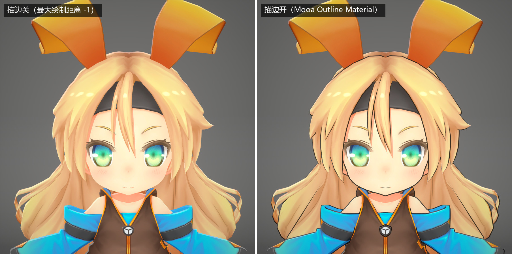

*5.7 实拍，同一魔改引擎内调参：把 UnityChan 骨骼网格组件的 Mooa Outline Material Max Draw Distance 设为 −1（左，描边关闭）和默认值（右）。关闭后头发、脸、发饰和衣服边缘的黑色描边线都消失了，其余着色不变。*

**好处**：描边是组件上的一个槽，不改模型、不加组件、不增加材质段；有独立的最大绘制距离和画质档位缩放，远处角色可以自动去掉描边；过场动画里可以用 Sequencer 给描边参数打关键帧。这部分是 Runtime/Engine 模块改动量大的主要原因，因为要让静态网格、骨骼网格、实例化、植被、地形全部支持。

### 4.9 各向异性与切线

| 文件 | 在引擎中的职责 | 改动 |
|---|---|---|
| `Source/Runtime/Renderer/Private/AnisotropyRendering.cpp` | 各向异性 pass，把切线和各向异性写进 GBufferF | Toon 加入允许的着色模型 |
| `Source/Runtime/Renderer/Private/PrimitiveSceneInfo.cpp`、`Source/Runtime/Engine/Private/Materials/MaterialInterface.cpp` | 判断网格是否需要各向异性 pass | 同上 |
| `Shaders/Private/AnisotropyPassShader.usf` | 各向异性 pass 的着色器 | 面部 SDF 模式下写入右脸 SDF |
| `Shaders/Private/MaterialTemplate.ush`、`HLSLMaterialTranslator.cpp` | 材质模板 | Toon 的切线输入处理 |

UE 的延迟管线里，世界切线和各向异性强度不在 BasePass 里写，而是由一个单独的各向异性 pass 写进 GBufferF，并且只有少数几种着色模型有资格进入这个 pass。

**关键代码与含义**

**(1) 让 Toon 进入各向异性 pass**

```diff
 // Source/Runtime/Renderer/Private/AnisotropyRendering.cpp:42
-		MaterialParameters.ShadingModels.HasAnyShadingModel({ MSM_DefaultLit, MSM_ClearCoat, MSM_Strata }) &&
+		MaterialParameters.ShadingModels.HasAnyShadingModel({ MSM_DefaultLit, MSM_ClearCoat, MSM_Strata, MSM_Toon }) && // Mooa Anisotropy
```

```cpp
// Source/Runtime/Engine/Private/Materials/HLSLMaterialTranslator.cpp:2093
// Mooa Anisotropy
// MooaToon uses 0 as the default value for Tangent and converts it to World Tangent before output.
// Non-zero values are output as-is.
bUsesAnisotropy = bUsesAnisotropy != 0
            || (IsMaterialPropertyUsed(MP_Tangent, Chunk[MP_Tangent], FLinearColor(0, 0, 0, 0), 3)
                    && MaterialShadingModels.HasShadingModel(MSM_Toon));
```

- 第一段是"哪些材质要编译各向异性 pass 的 shader"的白名单，加入 `MSM_Toon`。同文件 148 行"哪些网格要画进这个 pass"的判断也做了同样的修改。
- 第二段放宽了"材质是否使用了各向异性"的判定：原版要求 Anisotropy 引脚有连线；Toon 材质只要 **Tangent** 引脚有连线就算。原因在 (3)：面部材质并不需要各向异性高光，但需要借这个 pass 把切线写进 GBuffer。

**(2) Toon 的切线直接当世界向量用**

```hlsl
// Shaders/Private/MaterialTemplate.ush:4223
// Mooa Anisotropy
BRANCH if (all(Tangent == 0))
#if MATERIAL_TANGENTSPACENORMAL && !MATERIAL_SHADINGMODEL_TOON
        Tangent = float3(1, 0, 0);
#else
        Tangent = Parameters.TangentToWorld[0];
#endif
        
#if MATERIAL_SHADINGMODEL_TOON
    Tangent = normalize(Tangent);
#else
#if MATERIAL_TANGENTSPACENORMAL
    Tangent = TransformTangentNormalToWorld(Parameters.TangentToWorld, Tangent);
#endif
    float3 BiTangent = cross(Normal, Tangent);
    Tangent = normalize(cross(BiTangent, Normal));
#endif
// Mooa End
```

- 原版流程（`#else` 分支）：把材质输出的切线从切线空间变换到世界空间，再对法线做一次正交化，保证切线垂直于法线。
- Toon 流程：材质输出什么就是什么，只做归一化。不变换，也不正交化。引脚为 0（没有连线）时取网格自身的世界切线，行为和普通材质一致。
- 这样 Tangent 引脚就成了一个**可以存任意世界方向的通道**。头发材质可以写入发丝方向给 Kajiya-Kay 高光用；面部材质可以写入"脸的正前方"，这个方向通常并不垂直于脸上各点的法线，原版的正交化会把它破坏掉。

**(3) SDF 模式下借用 Anisotropy 通道**

```hlsl
// Shaders/Private/AnisotropyPassShader.usf:167
// Mooa Anisotropy
#if MATERIAL_SHADINGMODEL_TOON
    FToonGBufferData ToonGBuffer = DecodeToonGBufferDataFromMaterialAttribute(
        GetMaterialMooaEncodedAttribute0(PixelMaterialInputs),
        GetMaterialMooaEncodedAttribute1(PixelMaterialInputs),
        GetMaterialMooaEncodedAttribute2(PixelMaterialInputs),
        GetMaterialMooaEncodedAttribute3(PixelMaterialInputs),
        GetMaterialMooaEncodedAttribute4(PixelMaterialInputs));

    EncodeToonGBufferDataToAnisotropy(ToonGBuffer, Anisotropy);
#endif
// Mooa End
```

- 各向异性 pass 是独立于 BasePass 的另一次绘制，所以这里把 5 个引脚重新解码了一遍。
- `EncodeToonGBufferDataToAnisotropy` 在 SDF 面部阴影模式下执行 `Anisotropy = FacialShadowSdfRight * 2.0f - 1.0f`，把右脸 SDF 值放进 GBufferF 的各向异性通道（这个通道的取值范围是 −1 到 1，所以做了一次映射）。其他模式下不改动。
- 对照 4.2 节的位布局表：左脸 SDF 借用 Metallic，右脸 SDF 借用 Anisotropy，脸的朝向借用 WorldTangent。4.4 节的 `ApplyDistanceFieldFacialShadow` 读的就是这三样。

**好处**：Toon 材质能用引擎原生的各向异性高光（头发、金属拉丝），同一个切线通道在面部材质上被复用为"脸的朝向"，供 SDF 阴影使用，没有为此再加一张 GBuffer。

### 4.10 Morph Target 法线强度

表情用的 Morph Target 通常会连带修改法线，而卡通角色的脸部法线往往是精心修过的（例如球面化），表情一动，阴影就跟着乱。

| 文件 | 在引擎中的职责 | 改动 |
|---|---|---|
| `EngineTypes.h` | `FSkeletalMeshBuildSettings`，每个 LOD 的构建设置 | 新增 `MooaMorphTargetsNormalIntensity`，默认 1 |
| `Source/Developer/SkeletalMeshUtilitiesCommon/Private/LODUtilities.cpp` | 骨骼网格 LOD 构建，包括 Morph Target 增量 | 法线增量乘以强度 |
| `Source/Runtime/Engine/Private/SkinnedAssetCommon.cpp` | 构建设置的序列化与派生数据键 | 新设置参与序列化 |
| `Source/Editor/Persona/Private/PersonaMeshDetails.{h,cpp}` | 骨骼网格编辑器的细节面板 | 显示该设置 |
| `Source/Editor/UnrealEd` 下的 FBX 导入相关文件 | FBX 导入选项与流程 | 导入时可指定强度 |
| `Config/BaseEngine.ini`、`BaseEditorPerProjectUserSettings.ini` | 引擎默认配置 | 旧属性名的重定向和默认值 |

**关键代码与含义**

**(1) 一个新的构建设置**

```cpp
// Source/Runtime/Engine/Classes/Engine/EngineTypes.h:2927
// Mooa Blend Shape Normal
/** If 0, Morph Targets will not affect Normals.*/
UPROPERTY(EditAnywhere, BlueprintReadWrite, Category = BuildSettings)
float MooaMorphTargetsNormalIntensity;
```

- 加在 `FSkeletalMeshBuildSettings` 里，和"重算法线""重算切线"等选项并列，每个 LOD 各有一份，在骨骼网格编辑器的 LOD 设置里可见。构造函数里默认值是 `1.0f`，即保持原版行为。

**(2) 构建时缩放法线增量**

```cpp
// Source/Developer/SkeletalMeshUtilitiesCommon/Private/LODUtilities.cpp:3403
// Mooa Blend Shape Normal
{
    check(BaseSkelMesh->GetImportedModel());
    check(BaseSkelMesh->GetImportedModel()->LODModels.IsValidIndex(LODIndex));
    check(BaseSkelMesh->GetLODInfo(LODIndex) != nullptr);

    const FSkeletalMeshLODInfo* LODInfo = BaseSkelMesh->GetLODInfo(LODIndex);
    const float MooaMorphTargetsNormalIntensity = LODInfo->BuildSettings.MooaMorphTargetsNormalIntensity;
    for (TArray< FMorphTargetDelta >* Result : Results)
    {
        for (FMorphTargetDelta& Delta : *Result)
        {
            Delta.TangentZDelta *= MooaMorphTargetsNormalIntensity;
        }
    }
}
```

- Morph Target 在引擎里存的是每个受影响顶点的"增量"：位置增量 `PositionDelta` 和法线增量 `TangentZDelta`（TangentZ 就是法线）。
- 这段代码插在所有 Morph Target 的增量计算完成之后、写入最终数据之前，把每个法线增量乘以强度，位置增量不动。
- 强度为 0 时法线增量全部清零：表情仍然移动顶点，但法线保持基础网格上修好的样子。也可以取 0 到 1 之间的值保留一部分法线变化。

**(3) 让设置参与缓存键，并兼容旧资产**

```cpp
// Source/Runtime/Engine/Private/SkinnedAssetCommon.cpp:141
Ar << BuildSettings.MorphThresholdPosition;
// Mooa Blend Shape Normal
Ar << BuildSettings.MooaMorphTargetsNormalIntensity;
// Mooa End
Ar << BuildSettings.BoneInfluenceLimit;
```

```ini
; Config/BaseEngine.ini:1354
; Mooa Blend Shape Normal
+PropertyRedirects=(OldName="/Script/Engine.SkeletalMeshBuildSettings.MorphTargetsNormalIntensity",NewName="/Script/Engine.SkeletalMeshBuildSettings.MooaMorphTargetsNormalIntensity")
```

- 第一段在构建设置的序列化函数里，引擎用它的输出计算派生数据缓存（DDC）的键。新设置写进去之后，改动强度会得到不同的键，触发重新构建；否则引擎会直接复用旧的构建结果，改了等于没改。
- 第二段是属性重定向：这个属性在早期版本里叫 `MorphTargetsNormalIntensity`，后来统一加了 `Mooa` 前缀。重定向让旧版本保存的资产加载时自动把值读到新名字上。同样的重定向还有两行，分别对应 FBX 导入数据和场景导入选项里的同名属性。

**好处**：设为 0 时表情只移动顶点、不改法线，脸部阴影形状保持稳定。它是构建期的处理，运行时没有额外开销。

### 4.11 全局参数通路

逐材质的参数走 GBuffer，全局参数走另一条路：后处理体积、控制台变量、项目设置，最终都汇入 View Uniform Buffer，也就是 shader 里的 `View.xxx`。

| 文件 | 在引擎中的职责 | 改动 |
|---|---|---|
| `Classes/Engine/Scene.h`、`Private/Scene.cpp` | `FPostProcessSettings`，后处理体积的全部参数 | 新增 Mooa Toon 分类 |
| `Private/SceneView.cpp` | 多个后处理体积之间的混合 | 新参数参与混合 |
| `Public/SceneView.h` | View Uniform Buffer 的字段声明 | 新增 `View.Mooa*` 字段 |
| `Source/Runtime/Renderer/Private/SceneRendering.cpp` | 每帧填充 View Uniform Buffer，也是渲染控制台变量的集中地 | 新增 `r.Mooa.*` 变量并填充字段，单文件新增 120 行 |
| `Private/SceneManagement.cpp` | `FViewUniformShaderParameters` 的构造函数，给纹理字段赋默认值 | Ramp 图集默认绑定白色纹理 |
| `Public/MooaToonSettings.h`、`Private/MooaToonSettings.cpp`（新增） | 项目设置页 | 指定两张全局 Ramp 图集 |
| `Public/Subsystems/MooaToonSubsystem.h`、`Private/Subsystems/MooaToonSubsystem.cpp`（新增） | 引擎子系统 | 启动时加载 Ramp 图集并保持引用 |

未写全路径的文件都在 `Source/Runtime/Engine` 下。

**关键代码与含义**

后处理参数一共 21 个，每个参数的代码都是同一个模式，下面以 Exposure Scale 为代表，看一个参数从编辑器面板走到 shader 要经过哪几处。

**(1) 声明：一个 override 位加一个参数本体**

```cpp
// Source/Runtime/Engine/Classes/Engine/Scene.h:1233
// Mooa Post Processing
UPROPERTY(EditAnywhere, BlueprintReadWrite, Category=Overrides, meta=(PinHiddenByDefault, InlineEditConditionToggle))
uint8 bOverride_MooaExposureScale:1;
// 以下在 2377 行
// Mooa Post Processing
UPROPERTY(interp, BlueprintReadWrite, Category="Mooa Toon", meta=(ClampMin = "0.0", UIMax = "2.0", editcondition = "bOverride_MooaExposureScale", DisplayName = "Exposure Scale"))
float MooaExposureScale;
```

- `FPostProcessSettings` 是后处理体积、相机组件共用的参数结构。引擎的约定是每个参数配一个 `bOverride_` 位：细节面板里参数前面的那个勾就是它，不勾表示"这个体积不管这一项"。
- `interp` 让参数可以被 Sequencer 打关键帧；`editcondition` 把参数和它的勾关联起来；`Category="Mooa Toon"` 决定它出现在面板的哪个分类下，其他参数用了 `Mooa Toon|Indirect Lighting`、`Mooa Toon|Direct Lighting - Shadow` 这样的子分类。
- 开关型参数（四种光源各自的头发阴影、面部 SDF 阴影开关）声明成 `uint32 ...:1` 的位域，其余是 `float`，GI Color 是 `FLinearColor`。

**(2) 默认值**

```cpp
// Source/Runtime/Engine/Private/Scene.cpp:635（节选）
// Mooa Post Processing
MooaExposureScale = 1.0f;
MooaLightSaturationScale = 1.0f;
MooaGlobalIlluminationDirectionality = 1.0f;
MooaGlobalIlluminationLumenNormalFlatten = 0.0f;
MooaGlobalIlluminationColor = FLinearColor(1.0f, 1.0f, 1.0f, 0.0f);
MooaGlobalIlluminationIntensity = 0.0f;
MooaShadowBias = 0.0f;
MooaEnableScreenSpaceHairShadowDirectionalLights = true;
// 其余 7 个开关同样是 true，此处省略
MooaShadowColorIntensityDirectionalLights = 1.0f;
MooaShadowColorIntensityPointLights = 0.0f;
MooaShadowColorIntensitySpotLights = 0.0f;
MooaShadowColorIntensityRectLights = 0.0f;
MooaRimLightIntensity = 1.0f;
MooaRimLightSaturationScale = 1.0f;
// Mooa End
```

- 这是 `FPostProcessSettings` 构造函数里的一段。场景里没有任何后处理体积覆盖这些参数时，shader 拿到的就是这组值。
- 默认值的取法是"不改变画面"：曝光和饱和度缩放为 1，法线压平和 Shadow Bias 为 0，GI Color 的 alpha 为 0（正片叠底模式下乘以白色）。
- 下面的参数表就是从这段代码整理出来的。

**(3) 多个体积之间的混合**

```cpp
// Source/Runtime/Engine/Private/SceneView.cpp:1759
// Mooa Post Processing
LERP_PP(MooaExposureScale);
LERP_PP(MooaLightSaturationScale);
LERP_PP(MooaGlobalIlluminationDirectionality);
// 其余 18 个参数各一行，此处省略
// Mooa End
```

- 位置在 `FSceneView::OverridePostProcessSettings`。相机每帧会收集它所在的所有后处理体积，按优先级和混合权重依次调用这个函数，把结果累积到 `FinalPostProcessSettings`。
- `LERP_PP` 是引擎原有的宏（同文件 1561 行），展开后是：如果来源体积勾了这个参数的 override，就按权重在当前值和来源值之间插值。
- 所以新参数自动获得了后处理体积的全部行为：走进体积时按 Blend Radius 渐变，多个体积按 Priority 叠加。

**(4) 送进 View Uniform Buffer**

```cpp
// Source/Runtime/Engine/Public/SceneView.h:848（节选）
// Mooa View Uniform Buffer
// View uniform buffer member declarations
#define VIEW_UNIFORM_BUFFER_MEMBER_TABLE \
    VIEW_UNIFORM_BUFFER_MEMBER(float, MooaDebugValue) \
    VIEW_UNIFORM_BUFFER_MEMBER(float, MooaDynamicAOIntensity) \
    VIEW_UNIFORM_BUFFER_MEMBER(uint32, MooaDiffuseColorRampEnablePostRampShadow) \
    VIEW_UNIFORM_BUFFER_MEMBER(float, MooaExposureScale) \
    VIEW_UNIFORM_BUFFER_MEMBER(FVector4f, MooaGlobalIlluminationColor) \
    VIEW_UNIFORM_BUFFER_MEMBER(uint32, MooaWorldType) \
    VIEW_UNIFORM_BUFFER_MEMBER_PER_VIEW(FMatrix44f, TranslatedWorldToClip) \
```

```cpp
// Source/Runtime/Renderer/Private/SceneRendering.cpp:1460（节选）
// Post Processing
ViewUniformShaderParameters.MooaExposureScale										= FinalPostProcessSettings.MooaExposureScale;
ViewUniformShaderParameters.MooaLightSaturationScale								= FinalPostProcessSettings.MooaLightSaturationScale;
// 其余 19 个参数各一行，此处省略
// 以下在 1507 行
// Lighting
if (Scene)
{
    ViewUniformShaderParameters.MooaWorldType = Scene->World->WorldType;
}
// Mooa End
```

- 第一段是 View Uniform Buffer 的成员表。这个宏会同时展开成 C++ 结构体的成员和 shader 里 `View` 结构的字段，所以在表里加一行，shader 就能直接写 `View.MooaExposureScale`。MooaToon 在表的最前面插了 35 行：13 个控制台变量、21 个后处理参数、1 个 `MooaWorldType`，后面才是原有的 `TranslatedWorldToClip` 等成员。上面只贴了有代表性的 6 行。
- 第二段在 `FViewInfo::SetupUniformBufferParameters` 里，每个视图每帧执行一次，把混合好的 `FinalPostProcessSettings` 逐项抄进 Uniform Buffer。
- `MooaWorldType` 是当前场景所属 World 的类型（游戏、编辑器、编辑器预览等）。shader 侧用它设置 `MooaToonContext.IsEditorPreviewWorldType`（`ToonShadingCommon.ush:426`），用来识别材质编辑器预览这类视口。引擎自带的 shader 里目前只是把它记进上下文，没有再拿它做分支。

shader 这一头的用法很直接。带光源类型的参数用一个小函数分发，4.4 节里的 `GetShadowColorIntensity` 就是它：

```hlsl
// Shaders/Private/ToonShadingModel.ush:22
half GetShadowColorIntensity(FMooaToonContext MooaToonContext)
{
    if (MooaToonContext.LightType == MOOA_LIGHT_TYPE_DIRECTIONAL)
        return View.MooaShadowColorIntensityDirectionalLights;
    else if (MooaToonContext.LightType == MOOA_LIGHT_TYPE_POINT)
        return View.MooaShadowColorIntensityPointLights;
    else if (MooaToonContext.LightType == MOOA_LIGHT_TYPE_SPOT)
        return View.MooaShadowColorIntensitySpotLights;
    else
        return View.MooaShadowColorIntensityRectLights;
}
```

- `MooaToonContext.LightType` 是延迟光照阶段填进去的（4.5 节），这里按它选出四个后处理参数之一。头发阴影开关和面部 SDF 阴影开关各有一个写法相同的函数。

**(5) 控制台变量：同一条路，少两步**

```cpp
// Source/Runtime/Renderer/Private/SceneRendering.cpp:136（节选）
//Mooa Console Variable
static TAutoConsoleVariable<int32> CMooaDiffuseColorRampEnablePostRampShadow(
    TEXT("r.Mooa.DiffuseColorRamp.EnablePostRampShadow"), 0,TEXT("If enabled, Shadows will not affect the Diffuse Color Ramp samples."), ECVF_RenderThreadSafe);
static TAutoConsoleVariable<float> CMooaHairShadowIntensity(
    TEXT("r.Mooa.HairShadow.Intensity"), 1.0f,TEXT("Hair Shadow Intensity"), ECVF_RenderThreadSafe);
// 以下在 1441 行
// Mooa View Uniform Buffer
ViewUniformShaderParameters.MooaDebugValue									= CMooaDebugValue.GetValueOnAnyThread();
ViewUniformShaderParameters.MooaDiffuseColorRampEnablePostRampShadow		= CMooaDiffuseColorRampEnablePostRampShadow.GetValueOnAnyThread();
ViewUniformShaderParameters.MooaHairShadowIntensity							= CMooaHairShadowIntensity.GetValueOnAnyThread();
```

- `TAutoConsoleVariable` 的三个参数是变量名、默认值、帮助文本。13 个变量都是这个写法，完整列表见下面的表。
- 控制台变量不需要声明属性和混合，定义之后直接在同一个函数里抄进 Uniform Buffer。它们是全局的，不随后处理体积变化，适合放"整个项目定一次"的量，例如 Ramp 偏移的最大范围、边缘光的最大宽度。
- 因为值是通过 Uniform Buffer 传的，在控制台里改完下一帧就生效，不触发 shader 重编译。4.4 节的头发阴影对比图就是直接切换 `r.Mooa.HairShadow.Intensity` 截的。

**(6) 全局 Ramp 图集：设置页、子系统、绑定、回退**

```cpp
// Source/Runtime/Engine/Public/MooaToonSettings.h:8
UCLASS(config = Engine, defaultconfig, meta = (DisplayName = "MooaToon"))
class ENGINE_API UMooaToonSettings : public UDeveloperSettings
{
    GENERATED_UCLASS_BODY()

public:
    UPROPERTY(config, EditAnywhere, Category = "MooaToon Settings", meta = (
        AllowedClasses = "/Script/Engine.CurveLinearColorAtlas",
        ConfigRestartRequired = true))
    FSoftObjectPath GlobalDiffuseColorRampAtlas = FSoftObjectPath(TEXT("/MooaToon/Assets/DiffuseColorRamps/CA_GlobalDiffuseColorRampAtlas.CA_GlobalDiffuseColorRampAtlas"));
    // GlobalSpecularColorRampAtlas 的声明与此相同，默认路径在 SpecularColorRamps 目录下，此处省略

#if WITH_EDITOR
    virtual void PostEditChangeProperty(FPropertyChangedEvent& PropertyChangedEvent) override;
#endif
};
```

- 继承 `UDeveloperSettings` 的类会自动出现在"项目设置"里，这里的显示名是 MooaToon。`config = Engine, defaultconfig` 表示值保存在工程的 `DefaultEngine.ini` 里，跟着工程走。
- 属性类型是软引用路径，只允许选 `CurveLinearColorAtlas`（曲线图集）资产。默认值指向 MooaToon 内容插件里自带的两张图集。
- `PostEditChangeProperty` 的实现（`MooaToonSettings.cpp:10`）在编辑器里改了设置后立即加载新图集并替换子系统里的引用，不用重启就能看到新 Ramp。

```cpp
// Source/Runtime/Engine/Private/Subsystems/MooaToonSubsystem.cpp:9
void UMooaToonSubsystem::Initialize(FSubsystemCollectionBase& Collection)
{
    Super::Initialize(Collection);
    auto MooaToonSettings = GetDefault<UMooaToonSettings>();
    GlobalDiffuseColorRampAtlas = (UCurveLinearColorAtlas*)MooaToonSettings->GlobalDiffuseColorRampAtlas.TryLoad();
    GlobalSpecularColorRampAtlas = (UCurveLinearColorAtlas*)MooaToonSettings->GlobalSpecularColorRampAtlas.TryLoad();
}
```

- `UEngineSubsystem` 跟随引擎启动和关闭，全局只有一个实例。启动时它读取上面的设置，把两张图集同步加载进来。
- 头文件里这两个成员是带 `UPROPERTY()` 的 `TObjectPtr`。这是强引用，垃圾回收不会把图集卸载掉，渲染线程每帧都能拿到有效的纹理。

```cpp
// Source/Runtime/Renderer/Private/SceneRendering.cpp:1483
// Global Ramps
if (auto MooaToonSubsystem = GEngine->GetEngineSubsystem<UMooaToonSubsystem>())
{
    FString NullRampName = TEXT("");
    if (MooaToonSubsystem->GlobalDiffuseColorRampAtlas != nullptr)
    {
        ViewUniformShaderParameters.MooaGlobalDiffuseColorRampAtlas = MooaToonSubsystem->GlobalDiffuseColorRampAtlas->TextureReference.TextureReferenceRHI;
        ViewUniformShaderParameters.MooaGlobalDiffuseColorRampAtlasHeight = MooaToonSubsystem->GlobalDiffuseColorRampAtlas->GetSurfaceHeight();
    }
    else NullRampName = TEXT("GlobalDiffuseColorRampAtlas");

    // Specular 图集的处理与上面相同，此处省略

    if (NullRampName != TEXT(""))
    {
        UE_LOG(LogCore, Error, TEXT("MooaToon: Can Not Load %s! Please Check Your MooaToon Editor Settings!"), *NullRampName);
    }
}
// 以下在 Source/Runtime/Engine/Private/SceneManagement.cpp:1311
// Mooa View Uniform Buffer Texture
MooaGlobalDiffuseColorRampAtlas = GWhiteTexture->TextureRHI;
MooaGlobalDiffuseColorRampAtlasHeight = 1;
MooaGlobalSpecularColorRampAtlas = GWhiteTexture->TextureRHI;
MooaGlobalSpecularColorRampAtlasHeight = 1;
// Mooa End
```

- 第一段每帧把图集的纹理和高度绑到 Uniform Buffer。高度就是图集里 Ramp 的行数，4.4 节的 `SampleGlobalRamp` 用它把"第几条 Ramp"换算成 V 坐标。
- 第二段是 Uniform Buffer 的默认值。图集没加载成功时，第一段的赋值被跳过，纹理字段保持为引擎的全局白色纹理、高度为 1：画面不会崩，只是 Ramp 采样恒为白色，同时日志里报一条错误，提示去检查 MooaToon 的设置。
- 纹理字段在 `SceneView.h:1157` 用 `SHADER_PARAMETER_TEXTURE` 单独声明，和引擎原有的纹理字段放在一起，没有进上面那张成员表。

后处理体积的 Mooa Toon 分类：

| 参数 | 默认值 | 作用 |
|---|---|---|
| Exposure Scale | 1 | Toon 像素的曝光补偿 |
| Light Saturation Scale | 1 | 光色饱和度 |
| GI Directionality | 1 | GI 方向性，0 为全方向平均 |
| GI Lumen Normal Flatten | 0 | Lumen 采样法线压平 |
| GI Color | (1, 1, 1, 0) | GI 调色，alpha 为 1 时替换 |
| GI Intensity | 0 | GI 强度 |
| Shadow Bias | 0 | 非光追阴影的偏移 |
| Enable Screen Space Hair Shadow，四种光源类型各一个 | 开 | 头发阴影开关 |
| Enable Distance Field Facial Shadow，四种光源类型各一个 | 开 | 面部 SDF 阴影开关 |
| Shadow Color Intensity，四种光源类型各一个 | 平行光 1，其余 0 | 哪类光源贡献阴影色 |
| Rimlight Intensity、Rimlight Saturation Scale | 1 | 边缘光全局强度与饱和度 |

阴影色强度默认只对平行光为 1，是为了避免多个光源重复叠加阴影色；室内没有平行光时，可以把其他类型调为 1 让它充当主光。GI Directionality 的源码注释还提到一点：它只在有天光时可用，室内等没有天光的场景需要保持为 1。

控制台变量：

| 变量 | 默认值 |
|---|---|
| `r.Mooa.DebugValue` | 0 |
| `r.Mooa.AmbientOcclusion.DynamicAOIntensity` | 0 |
| `r.Mooa.DiffuseColorRamp.EnablePostRampShadow` | 0 |
| `r.Mooa.DiffuseColorRamp.EnablePostRampMaterialAO` | 0 |
| `r.Mooa.DiffuseColorRamp.UVOffsetMaxRange` | 0.25 |
| `r.Mooa.SpecularColorRamp.UVOffsetMaxRange` | 0.25 |
| `r.Mooa.RimLight.MaxWidth` | 1 |
| `r.Mooa.RimLight.DepthTestThreshold` | 2 |
| `r.Mooa.RimLight.DepthTestFadeDistance` | 10 |
| `r.Mooa.HairShadow.Intensity` | 1 |
| `r.Mooa.HairShadow.Width` | 1 |
| `r.Mooa.HairShadow.DepthTestThreshold` | 0 |
| `r.Mooa.HairShadow.DepthTestFadeDistance` | 5 |

这一节没有单独配图。4.4 节的 Shadow Color Intensity 和 Rim Light Intensity 对比图、4.6 节的 Exposure Scale 与 GI Color 对比图，都是直接改这里的后处理参数截出来的。

**好处**：后处理体积的参数天然支持按区域混合和 Sequencer 关键帧，所以"进入室内时把聚光灯切换成角色主光""某个镜头单独提亮角色"都不需要改材质。全局 Ramp 图集让所有 Toon 材质共享两张纹理，材质只存一个索引，换一套 Ramp 就能整体换风格。加新参数的成本也低：照着上面的 (1) 到 (4) 各加一行，shader 里就能用。

### 4.12 杂项

剩下几处改动和卡通渲染本身无关，是为了开发和调试方便，或者没有带 Mooa 标记。

| 文件 | 改动 | 目的 |
|---|---|---|
| `Source/Developer/Windows/ShaderFormatD3D/Private/D3DShaderCompilerDXC.cpp` | DXC 编译参数加 `-Qembed_debug` | RenderDoc 里能看到 shader 源码 |
| `Config/BaseEngine.ini` | 本地 DDC 路径改到 `%GAMEDIR%LocalDerivedDataCache` | 派生数据缓存跟着工程走 |
| `Shaders/Private/ScreenSpaceDenoise/SSDSpatialKernel.ush` | 去掉两处循环上的 `LOOP` 属性 | 未加 Mooa 标记 |
| `Shaders/Private/Substrate/SubstrateRead.ush` | 一处兜底宏的值由 1 改为 0 | 未加 Mooa 标记 |

**关键代码与含义**

**(1) 让 RenderDoc 看到 shader 源码**

```cpp
// Source/Developer/Windows/ShaderFormatD3D/Private/D3DShaderCompilerDXC.cpp:246
if (Input.Environment.CompilerFlags.Contains(CFLAG_GenerateSymbols))
{
    // 此处原有 -Zss 与 -Zsb 的选择，未改动，省略

    // Mooa Add Renderdoc Debug Info
    // https://forums.unrealengine.com/t/unable-to-debug-shader-source-in-editor-using-renderdoc-plugin-in-5-6/2641328/2
    ExtraArguments.Add(TEXT("-Qembed_debug"));
    // Mooa End

    // generate the debug information (PDB)
    ExtraArguments.Add(TEXT("-Zi"));
```

- 这个文件负责把 HLSL 交给 DXC 编译成 D3D12 用的字节码，`ExtraArguments` 是传给 DXC 的命令行参数。
- 改动只有一行，位于"需要生成符号"的分支里，紧挨着原有的 `-Zi`（生成调试信息）。`-Qembed_debug` 要求 DXC 把调试信息直接嵌进编译产物。
- 注释里的链接是 Epic 论坛上的一个帖子，从标题看讨论的是 5.6 里用 RenderDoc 插件在编辑器中看不到 shader 源码的问题，这一行就是针对它加的。它只在开启了 shader 符号生成（`CFLAG_GenerateSymbols`）时才生效。

**(2) 本地派生数据缓存放进工程目录**

```ini
; Config/BaseEngine.ini:2748
; Mooa: Move LocalDerivedDataCache to Project Folder:
; - Path=%ENGINEDIR%DerivedDataCache => Path=%GAMEDIR%LocalDerivedDataCache
; - Path="%ENGINEVERSIONAGNOSTICUSERDIR%DerivedDataCache" => Path="%GAMEDIR%LocalDerivedDataCache"
Local=(Type=FileSystem, DeleteOnly=true, UnusedFileAge=8, Path=%GAMEDIR%LocalDerivedDataCache, EnvPathOverride=UE-LocalDataCachePath, EditorOverrideSetting=LocalDerivedDataCache, CommandLineOverride=LocalDataCachePath)
```

- 派生数据缓存（DDC）存的是编译好的 shader、压缩好的贴图这类"可以从源资产重新算出来"的数据。这个配置文件里每种 DDC 方案都有一条 `Local=`，定义本地缓存放在哪。
- 原版的路径是引擎目录或用户目录下的 `DerivedDataCache`。这里把全部 12 条 `Local=` 的路径都换成了工程目录下的 `LocalDerivedDataCache`，其余字段没动。
- 效果是缓存跟着工程走：删掉工程就连缓存一起清掉，不会在用户目录里越积越多；多份引擎或多个工程之间的缓存也不会混在一起。`EnvPathOverride` 和 `EditorOverrideSetting` 还在，仍然可以用环境变量或编辑器设置改到别处。

**(3) 两处没有标记的 shader 改动**

```diff
 // Shaders/Private/Substrate/SubstrateRead.ush:6
 #ifndef SUBSTRATE_ENABLED
-#define SUBSTRATE_ENABLED 1
+#define SUBSTRATE_ENABLED 0
 #error SUBSTRATE_ENABLED needs to be defined
 #endif
```

```diff
 // Shaders/Private/ScreenSpaceDenoise/SSDSpatialKernel.ush:1226
-		LOOP for (int x = -KernelRadius; x <= KernelRadius; x++)
+		for (int x = -KernelRadius; x <= KernelRadius; x++)
        {
-			LOOP for (int y = -KernelRadius; y <= KernelRadius; y++)
+			for (int y = -KernelRadius; y <= KernelRadius; y++)
```

- **`SubstrateRead.ush`**：这是一段防御性代码，`SUBSTRATE_ENABLED` 没有定义时才会进来，而且下一行就是 `#error`，编译会直接报错停下。所以把 1 改成 0 不改变任何编译结果，推测只是为了让 IDE 做语法分析时走非 Substrate 的分支，和 MooaToon 只支持传统 GBuffer 的现状一致。
- **`SSDSpatialKernel.ush`**：屏幕空间降噪器的空间滤波核。`LOOP` 是引擎的宏，要求编译器把循环保留为真正的循环而不是展开。这里去掉了两层循环上的这个属性，把选择权交还给编译器。源码里没有注释说明原因，这里如实记录，不做猜测。
- 这两处都不带 `// Mooa` 标记，是逐文件 diff 时才发现的。合并新版引擎时如果只按标记搜索，会漏掉它们。

另外有两个 shader 文件的开头多了几行被注释掉的宏定义，分别标着 `// Mooa For Rider` 和 `// Mooa Debug`：

```hlsl
// Shaders/Private/DiffuseIndirectComposite.usf:7
// Mooa For Rider
// #define DIM_APPLY_DIFFUSE_INDIRECT 2
// #define SUBSTRATE_ENABLED 0
// Mooa End
```

- 这些宏正常情况下由 C++ 在编译 shader 时传入，IDE 单独打开文件时不知道它们的值，大片代码会被当成"未激活"而变灰。调试时取消注释，IDE 就能正确高亮和跳转。它们现在是注释状态，不参与编译。`RayTracing/RayTracingMaterialHitShaders.usf` 的第 5 到 10 行是同样的用途。

**好处**：前两项直接改善了开发体验，调 shader 时能在 RenderDoc 里对着源码单步，缓存也好管理。后面几项对画面没有影响，列在这里是为了让这份对比完整。

## 5. 插件与示例工程

引擎改动只提供能力，真正可用的材质和工具在插件里。

**引擎插件 `Engine/Plugins/MooaToonScripts`**

依赖 Geometry Scripting，包含运行时模块和编辑器模块。编辑器模块的 `UMooaToonEditorBPLibrary` 提供一组蓝图函数：

- 读写静态网格和骨骼网格的导入数据：位置、索引、法线、切线、副法线、顶点色、4 套 UV。
- `Mooa Get Mesh Normal Diff Curvatures`：以顶点与周围顶点的法线差异作为曲率。
- `Mooa Recompute MikkT Space Tangent Binormal`：重算 MikkTSpace 切线。
- `Mooa Find Nearest Points On DynamicMesh`：多线程加 BVH 的最近点查询。
- `Mooa Reimport Object Asset`：重新导入资产。

这些函数是描边用的平滑法线烘焙工具的基础。

**引擎插件 `Engine/Plugins/MooaToonThirdparty`**：VRM4U 和 KawaiiPhysics。

**原生插件的配套修改**

新增的组件属性和 GBuffer 也要同步到用到它们的原生插件里。`Engine/Plugins` 与原版对比的结果是：32 个文件带 Mooa 标记，共新增 338 行，没有删除。

| 插件 | 文件数 | 新增行 | 同步的功能 |
|---|---|---|---|
| `Media/MediaPlate` | 2 | 96 | 描边材质 |
| `ChaosClothAsset` | 2 | 73 | 描边材质 |
| `Interchange` | 8 | 63 | Morph 法线、描边材质 |
| `Experimental/FastGeoStreaming` | 7 | 44 | 阴影通道、描边材质 |
| `PCG` | 3 | 18 | 描边材质、阴影通道 |
| `VirtualProduction/CameraCalibrationCore` | 3 | 12 | 描边材质 |
| `VirtualProduction/CameraCalibration` | 2 | 10 | 描边材质 |
| `Experimental/PCGInterops` | 1 | 7 | 描边材质 |
| `VirtualProduction/TextureShare` | 2 | 6 | GBuffer |
| `Runtime/InstancedActors` | 1 | 6 | 描边材质 |
| `Mutable` | 1 | 3 | Morph 法线 |

基本都是"把新属性传下去"：PCG、FastGeo、InstancedActors 这类自己创建网格代理或实例描述符的插件要带上描边材质（PCG 和 FastGeo 还有阴影通道）；MediaPlate 仿照它对 Overlay Material 的处理补了一套描边材质逻辑，相机标定工具则是在 `GetOverlayMaterial` 旁边加了对应的空接口；Interchange 导入管线要认识 Morph 法线强度；Chaos Cloth 资产和骨骼网格一样有资产级的默认描边材质；TextureShare 登记了 `ToonBufferA` 的名字。

另有 18 个 `Plugins/Fab` 下的文件与安装版不同，但不带任何 Mooa 标记，属于 Fab 插件自身的版本差异，没有计入。

**工程内容插件 `MooaToon-Project/Plugins/MooaToon`**

- 材质：`M_Toon`、`M_ToonLayer`、`M_Outline`、`M_OverlayOutline`、`M_PP_BlurredOutline`、`M_PP_Debug`，以及半透明、双面、VRM 等材质实例。
- 材质函数：`MF_MooaEncodeAttributes`、`MF_MooaDecodeAttributes`、`MF_MooaSetAttributes`、`MF_MooaToonBaseInput`、`MF_MooaToonStep`、`MF_MooaMainLightDirection`、`MF_TranslucencyShadowToOpacityMask` 等。
- 材质层：`ML_ToonBaseInput`、`MLB_ToonBaseBlend`。
- 资源：Diffuse、Specular 两套全局 Ramp 图集，描边宽度 Ramp，Ramp 曲线和编辑器工具蓝图。

**示例内容 `MooaToon-Project/Content/MooaToonSamples`**

| 关卡 | 用途 |
|---|---|
| `L_LookDev`、`L_LookDev_Lighting` | 材质球、色卡和多种灯光下的 LookDev |
| `L_LookDev_UnityChan` 及 `_GIFirst`、`_Pose` 变体 | UnityChanSD 角色展示 |
| `L_LookDev_VRM` | VRM 角色 |
| `L_TimeOfDay_Require_UltraDynamicSky` | 昼夜变化，需要 Ultra Dynamic Sky |
| `VolumetricPainting/L_VolumetricPainting` | 体积绘制示例 |

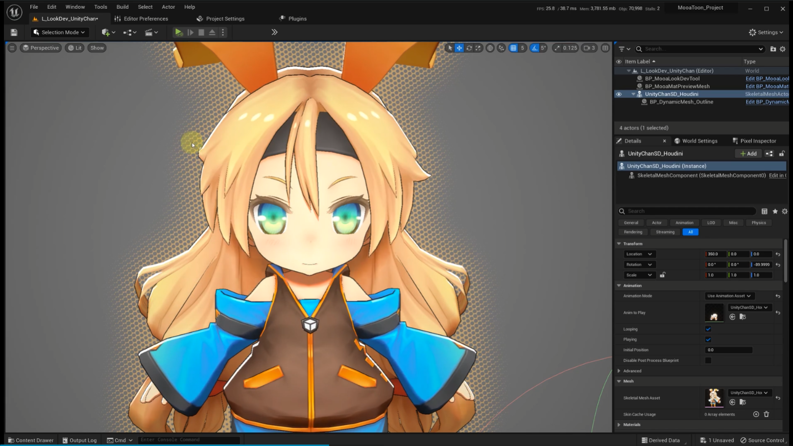

*`L_LookDev_UnityChan` 关卡在仓库 README 里的样子，可以和文章开头同一关卡的当前 5.7 实拍图对照。（README 截图，早期版本）*

配套蓝图有 `BP_MooaLookDevTool`、`BP_MooaMatPreviewMesh`、`BP_ColorCalibrator`、`BP_Material_Array`。工程的渲染设置为 Lumen GI 与反射、虚拟阴影贴图、硬件光追与光追阴影全开。

## 6. 代价与注意事项

这套方案不是免费的，用之前应该知道：

- **显存和带宽**：`ToonBufferA` 是一张全屏的 RGBA16 渲染目标。只要用这份引擎，它就会被创建并挂到 BasePass 上，不管画面里有没有 Toon 材质；所有材质的 BasePass 输出也因此多了一个槽位（4.2 节的 (2)，那个"只对 Toon 材质生效"的条件被注释掉了）。真正往里写数据的只有 Toon 材质。
- **渲染目标数量逼近上限**：BasePass 的 MRT 上限是 8 个。为此单层水的强制速度输出被默认关闭，再往 BasePass 加 RT 的功能可能冲突。
- **着色模型 ID 所剩不多**：GBuffer 里的着色模型 ID 只有 4 bit（`ShadingCommon.ush` 里 `SHADINGMODELID_MASK` 为 `0xF`），最多 16 个。Toon 占了 13，之后只剩 14 和 15 两个空位。Epic 以后新增着色模型时，合并可能要重新排号。
- **未适配 Substrate**：Toon 的延迟光照分支用 `!SUBSTRATE_ENABLED` 守卫，`ToonBufferA` 也挂在传统 GBuffer 上，没有对应的 Substrate 实现。
- **未接入移动端渲染路径**：对比结果里没有任何 `Mobile*` 着色器被修改。
- **光追开销**：Toon 的不透明材质也要执行任意命中着色器，光追负载增加 4 字节。
- **光追阴影靠"`ToonBufferA` 不全为 0"识别 Toon 像素**（`RayTracingOcclusionRGS.usf:778`）：理论上，如果某个 Toon 像素编码后四个通道恰好全是 0，它会被当成非 Toon 像素，4.7 节的 Stencil 逻辑对它不生效。这要求高光色为纯黑、两个 Ramp 偏移都推到最小值、两个 Ramp 索引和 Stencil 都是 0、边缘光为 0，正常材质很难同时满足，但它是这个判断方式的一个隐含前提。
- **SDF 面部阴影占用了 Metallic 和 Anisotropy**：这种模式下，左右两个 SDF 值借用 GBuffer 的 Metallic 和 Anisotropy 通道存放，Tangent 引脚用来传脸的朝向（4.4 节的 (3)）。所以启用 SDF 面部阴影的材质不能再用金属度和各向异性。
- **屏幕空间效果的固有局限**：头发阴影和边缘光依赖屏幕上的邻近像素，在屏幕边缘或被遮挡时会失效。
- **一处看起来放错位置的初始化**：`SkeletalMeshSceneProxy.cpp:108` 里，描边材质两个成员的初始化被包在了 `#if RHI_RAYTRACING` 里面，而它们在头文件（`SkeletalMeshSceneProxy.h:172`）里的声明不在这个宏里，也没有默认值：

  ```cpp
  // Source/Runtime/Engine/Private/SkeletalMeshSceneProxy.cpp:108
  #if RHI_RAYTRACING
        // Mooa Outline Material
        ,   MooaOutlineMaterial(InMeshDesc.GetMooaOutlineMaterial())
        ,   MooaOutlineMaterialMaxDrawDistance(InMeshDesc.GetMooaOutlineMaterialMaxDrawDistance())
        // Mooa End
  #endif
  ```

  在 `RHI_RAYTRACING` 为 0 的平台上，这两个成员不会被初始化，4.8 节 (3) 里的 `MooaOutlineMaterial != nullptr` 读到的就是未定义的值。Windows 桌面平台这个宏为 1，不受影响。它看起来是合并代码时误放进了宏里，移植到不支持光追的平台之前需要挪出来。
- **必须使用这份引擎**：材质引脚、着色模型和组件属性都在引擎里，资产在原版引擎中无法正确渲染。
- **版本升级成本**：144 个被修改的文件每次引擎升级都要合并。好在改动绝大多数带标记，并且以追加为主；不带标记的两处见 4.12 节。

## 7. 参考与许可

- MooaToon 主页与文档：https://mooatoon.com/
- 许可：https://mooatoon.com/docs/Licence/
- VRM4U，作者 ruyo：https://github.com/ruyo/VRM4U
- UnityChan © UTJ/UCL：https://unity-chan.com/
- SDF 阴影阈值图生成工具，作者 akasaki1211：https://github.com/akasaki1211/sdf_shadow_threshold_map
- Unreal Engine 源码及其衍生修改受 Epic Games 的 EULA 约束。

## 附录：完整改动文件清单

小节标题是相对于 `Engine/` 的目录，表内路径相对于小节标题。增删行数在统一换行符后统计。

"功能标记"一列是文件里 `// Mooa <名称>` 注释的名称，可以据此在源码里搜到对应的改动块。

### `Shaders`（32 个文件，+1416 行）

| 文件 | 增 / 删 | 功能标记 |
|---|---|---|
| `Private/AnisotropyPassShader.usf` | +13 / −0 | Anisotropy |
| `Private/BasePassCommon.ush` | +2 / −1 | Toon Shading Model |
| `Private/BasePassPixelShader.usf` | +64 / −2 | For Rider、Encode GBuffer、GBuffer、Forward Shading |
| `Private/ClusteredDeferredShadingPixelShader.usf` | +3 / −0 | Toon Shading Model |
| `Private/Common.ush` | +1 / −1 | 无标记 |
| `Private/DeferredLightingCommon.ush` | +16 / −1 | Toon Shading、GBuffer |
| `Private/DeferredLightPixelShaders.usf` | +17 / −0 | Toon Shading Model、GBuffer、Toon Deferred Shading |
| `Private/DeferredShadingCommon.ush` | +41 / −6 | GBuffer、Toon Shading Model、GBuffer Decode |
| `Private/Definitions.usf` | +6 / −0 | Toon Shading Model |
| `Private/DiffuseIndirectComposite.usf` | +47 / −1 | For Rider、Indirect Lighting |
| `Private/DistanceFieldShadowing.usf` | +7 / −0 | Shadow |
| `Private/GBufferHelpers.ush` | +17 / −0 | GBuffer Decode |
| `Private/Lumen/LumenScreenProbeGather.usf` | +11 / −0 | Indirect Lighting |
| `Private/MaterialTemplate.ush` | +45 / −2 | GBuffer、Ray Tracing Shadow、Anisotropy |
| `Private/RayTracing/CompositeSkyLightPS.usf` | +4 / −0 | GI Intensity |
| `Private/RayTracing/RayTracingCommon.ush` | +39 / −0 | Ray Tracing、Ray Tracing Shadow |
| `Private/RayTracing/RayTracingDeferredShadingCommon.ush` | +4 / −1 | GBuffer |
| `Private/RayTracing/RayTracingMaterialHitShaders.usf` | +49 / −4 | Debug、Ray Tracing Shadow |
| `Private/RayTracing/RayTracingOcclusionRGS.usf` | +52 / −1 | Ray Tracing Shadow |
| `Private/ReflectionEnvironmentPixelShader.usf` | +12 / −0 | Indirect Lighting |
| `Private/ReflectionEnvironmentShared.ush` | +5 / −0 | Indirect Lighting |
| `Private/SceneTexturesCommon.ush` | +3 / −0 | GBuffer |
| `Private/ScreenSpaceDenoise/SSDCommon.ush` | +4 / −1 | GBuffer |
| `Private/ScreenSpaceDenoise/SSDSpatialKernel.ush` | +3 / −3 | 无标记 |
| `Private/ShadingCommon.ush` | +4 / −1 | Toon Shading Model |
| `Private/ShadingModels.ush` | +11 / −0 | Toon Shading Model |
| `Private/ShadowProjectionPixelShader.usf` | +33 / −1 | Shadow |
| `Private/Substrate/SubstrateRead.ush` | +1 / −1 | 无标记 |
| `Private/ToonShadingCommon.ush` | +478（新增文件） | — |
| `Private/ToonShadingModel.ush` | +402（新增文件） | — |
| `Private/VirtualShadowMaps/VirtualShadowMapProjection.usf` | +10 / −0 | Shadow |
| `Private/VirtualShadowMaps/VirtualShadowMapProjectionSpot.ush` | +12 / −0 | Shadow |

### `Source/Runtime/Engine`（58 个文件，+1345 行）

| 文件 | 增 / 删 | 功能标记 |
|---|---|---|
| `Classes/Components/MeshComponent.h` | +34 / −0 | Outline Material |
| `Classes/Components/PrimitiveComponent.h` | +26 / −0 | Shadow Channel Mask |
| `Classes/Components/SkinnedMeshComponent.h` | +8 / −0 | Outline Material |
| `Classes/Engine/EngineTypes.h` | +22 / −0 | Shadow Channel Mask、Toon Shading Model、Blend Shape Normal |
| `Classes/Engine/Scene.h` | +173 / −0 | Post Processing |
| `Classes/Engine/SkeletalMesh.h` | +52 / −0 | Outline Material |
| `Classes/Engine/SkinnedAsset.h` | +7 / −0 | Outline Material |
| `Classes/Engine/SplineMeshComponentDescriptor.h` | +15 / −0 | Shadow Channel Mask、Outline Material |
| `Private/Components/MeshComponent.cpp` | +54 / −0 | Outline Material |
| `Private/Components/PrimitiveComponent.cpp` | +19 / −0 | Shadow Channel Mask |
| `Private/Components/SkinnedMeshComponent.cpp` | +35 / −0 | Outline Material |
| `Private/HierarchicalInstancedStaticMesh.cpp` | +37 / −0 | Outline Material |
| `Private/InstancedStaticMesh.cpp` | +29 / −0 | Outline Material |
| `Private/ISMPartition/ISMComponentDescriptor.cpp` | +39 / −0 | Outline Material、Shadow Channel Mask |
| `Private/ISMPartition/ProceduralISMComponentDescriptor.cpp` | +12 / −0 | Outline Material、Shadow Channel Mask |
| `Private/Materials/HLSLMaterialTranslator.cpp` | +32 / −0 | Material Editor、Anisotropy、Toon Shading Model |
| `Private/Materials/Material.cpp` | +53 / −8 | Ray Tracing Shadow、Material Editor |
| `Private/Materials/MaterialAttributeDefinitionMap.cpp` | +30 / −0 | Material Editor |
| `Private/Materials/MaterialCachedData.cpp` | +7 / −0 | Material Editor |
| `Private/Materials/MaterialExpressions.cpp` | +37 / −2 | Material Editor |
| `Private/Materials/MaterialInterface.cpp` | +1 / −1 | Anisotropy |
| `Private/Materials/MaterialShader.cpp` | +2 / −0 | Toon Shading Model |
| `Private/MooaToonSettings.cpp` | +24（新增文件） | — |
| `Private/PrimitiveSceneProxy.cpp` | +24 / −0 | Shadow Channel Mask |
| `Private/PrimitiveSceneProxyDesc.cpp` | +3 / −0 | Shadow Channel Mask |
| `Private/Scene.cpp` | +23 / −0 | Post Processing |
| `Private/SceneManagement.cpp` | +7 / −0 | View Uniform Buffer Texture |
| `Private/SceneTexturesConfig.cpp` | +6 / −0 | GBuffer |
| `Private/SceneView.cpp` | +23 / −0 | Post Processing |
| `Private/ShaderCompiler/ShaderGenerationUtil.cpp` | +30 / −0 | Toon Shading Model、GBuffer |
| `Private/SkeletalMeshSceneProxy.cpp` | +64 / −0 | Outline Material |
| `Private/SkinnedAssetCommon.cpp` | +3 / −0 | Blend Shape Normal |
| `Private/SkinnedMeshSceneProxyDesc.cpp` | +25 / −0 | Outline Material |
| `Private/SplineMeshComponentDescriptor.cpp` | +39 / −0 | Outline Material、Shadow Channel Mask |
| `Private/StaticMeshSceneProxy.cpp` | +40 / −0 | Outline Material |
| `Private/StaticMeshSceneProxyDesc.cpp` | +4 / −0 | Outline Material |
| `Private/Subsystems/MooaToonSubsystem.cpp` | +23（新增文件） | — |
| `Private/UnrealEngine.cpp` | +14 / −0 | Outline Material |
| `Public/ISMPartition/ISMComponentDescriptor.h` | +15 / −0 | Shadow Channel Mask、Outline Material |
| `Public/ISMPartition/ProceduralISMComponentDescriptor.h` | +10 / −0 | Outline Material、Shadow Channel Mask |
| `Public/Materials/Material.h` | +17 / −0 | Material Editor |
| `Public/Materials/MaterialExpressionMakeMaterialAttributes.h` | +18 / −0 | Material Editor |
| `Public/MaterialShared.h` | +3 / −1 | 无标记 |
| `Public/MeshComponentHelper.h` | +8 / −0 | Outline Material |
| `Public/MooaToonSettings.h` | +28（新增文件） | — |
| `Public/PrimitiveSceneProxy.h` | +14 / −0 | Shadow Channel Mask |
| `Public/PrimitiveSceneProxyDesc.h` | +3 / −0 | Shadow Channel Mask |
| `Public/SceneTexturesConfig.h` | +3 / −0 | GBuffer |
| `Public/SceneTypes.h` | +7 / −0 | Material Editor |
| `Public/SceneView.h` | +43 / −0 | View Uniform Buffer、View Uniform Buffer Texture |
| `Public/SkeletalMeshSceneProxy.h` | +5 / −0 | Outline Material |
| `Public/SkinnedMeshComponentHelper.h` | +8 / −0 | Outline Material |
| `Public/SkinnedMeshSceneProxyDesc.h` | +10 / −0 | Outline Material |
| `Public/StaticMeshComponentHelper.h` | +23 / −0 | Outline Material |
| `Public/StaticMeshSceneProxy.h` | +5 / −0 | Outline Material |
| `Public/StaticMeshSceneProxyDesc.h` | +16 / −0 | Outline Material |
| `Public/Subsystems/MooaToonSubsystem.h` | +30（新增文件） | — |
| `Public/UnrealEngine.h` | +3 / −0 | Outline Material |

### `Source/Runtime/Renderer`（14 个文件，+184 行）

| 文件 | 增 / 删 | 功能标记 |
|---|---|---|
| `Internal/SceneTextures.h` | +3 / −0 | GBuffer |
| `Private/AnisotropyRendering.cpp` | +2 / −2 | Anisotropy |
| `Private/IndirectLightRendering.cpp` | +6 / −0 | GBuffer |
| `Private/LightSceneInfo.cpp` | +1 / −1 | Shadow Channel Mask |
| `Private/PlanarReflectionRendering.cpp` | +1 / −0 | GBuffer |
| `Private/PrimitiveSceneInfo.cpp` | +1 / −1 | Anisotropy |
| `Private/RayTracing/RayTracingMaterialHitShaders.cpp` | +2 / −1 | Ray Tracing Shadow |
| `Private/SceneRendering.cpp` | +120 / −0 | Include、Console Variable、GBuffer、View Uniform Buffer |
| `Private/SceneRendering.h` | +3 / −0 | GBuffer |
| `Private/SceneTextureParameters.cpp` | +6 / −0 | GBuffer |
| `Private/SceneTextureParameters.h` | +3 / −0 | GBuffer |
| `Private/SceneTextures.cpp` | +25 / −0 | GBuffer |
| `Private/SingleLayerWaterRendering.cpp` | +1 / −1 | GBuffer |
| `Public/SceneRenderTargetParameters.h` | +10 / −4 | GBuffer |

### `Source/Runtime/MovieSceneTracks`（5 个文件，+97 行）

| 文件 | 增 / 删 | 功能标记 |
|---|---|---|
| `Private/Systems/MovieSceneComponentMaterialSystem.cpp` | +26 / −0 | Outline Material |
| `Private/Tracks/MovieSceneCustomPrimitiveDataTrack.cpp` | +11 / −0 | Outline Material |
| `Private/Tracks/MovieSceneMaterialTrack.cpp` | +32 / −0 | Outline Material |
| `Private/Tracks/MovieScenePrimitiveMaterialTrack.cpp` | +19 / −0 | Outline Material |
| `Public/Tracks/MovieSceneMaterialTrack.h` | +9 / −0 | Outline Material |

### `Source/Editor/UnrealEd`（13 个文件，+81 行）

| 文件 | 增 / 删 | 功能标记 |
|---|---|---|
| `Classes/Factories/FbxSceneImportOptionsSkeletalMesh.h` | +6 / −0 | Blend Shape Normal |
| `Classes/Factories/FbxSkeletalMeshImportData.h` | +6 / −0 | Blend Shape Normal |
| `Private/Factories/EditorFactories.cpp` | +3 / −0 | Blend Shape Normal |
| `Private/Fbx/FbxMainImport.cpp` | +4 / −0 | Blend Shape Normal |
| `Private/Fbx/FbxSceneImportData.cpp` | +11 / −2 | Blend Shape Normal |
| `Private/Fbx/FbxSceneImportOptionsSkeletalMesh.cpp` | +6 / −0 | Blend Shape Normal |
| `Private/Fbx/FbxSkeletalMeshImport.cpp` | +6 / −0 | Blend Shape Normal |
| `Private/Fbx/FbxSkeletalMeshImportData.cpp` | +1 / −0 | Blend Shape Normal |
| `Private/Fbx/SFbxSceneOptionWindow.cpp` | +6 / −0 | Blend Shape Normal |
| `Private/FbxMeshUtils.cpp` | +3 / −0 | Blend Shape Normal |
| `Private/MaterialGraph.cpp` | +7 / −0 | Material Editor |
| `Private/MaterialGraphNode_Root.cpp` | +21 / −0 | Material Editor |
| `Public/FbxImporter.h` | +1 / −0 | Blend Shape Normal |

### `Source/Editor/MovieSceneTools`（2 个文件，+49 行）

| 文件 | 增 / 删 | 功能标记 |
|---|---|---|
| `Private/TrackEditors/MaterialTrackEditor.cpp` | +30 / −0 | Outline Material |
| `Private/TrackEditors/PrimitiveMaterialTrackEditor.cpp` | +19 / −0 | Outline Material |

### `Source/Runtime/Landscape`（6 个文件，+42 行）

| 文件 | 增 / 删 | 功能标记 |
|---|---|---|
| `Classes/LandscapeGrassType.h` | +15 / −0 | Shadow Channel Mask |
| `Classes/LandscapeProxy.h` | +15 / −0 | Shadow Channel Mask |
| `Private/Landscape.cpp` | +3 / −0 | Shadow Channel Mask |
| `Private/LandscapeEdit.cpp` | +3 / −0 | Shadow Channel Mask |
| `Private/LandscapeGrass.cpp` | +3 / −0 | Shadow Channel Mask |
| `Private/LandscapeNaniteComponent.cpp` | +3 / −0 | Shadow Channel Mask |

### `Source/Editor/Persona`（2 个文件，+41 行）

| 文件 | 增 / 删 | 功能标记 |
|---|---|---|
| `Private/PersonaMeshDetails.cpp` | +36 / −0 | Blend Shape Normal |
| `Private/PersonaMeshDetails.h` | +5 / −0 | Blend Shape Normal |

### `Source/Editor/MaterialEditor`（1 个文件，+35 行）

| 文件 | 增 / 删 | 功能标记 |
|---|---|---|
| `Private/MaterialEditor.cpp` | +35 / −0 | Material Editor |

### `Source/Runtime/RenderCore`（5 个文件，+32 行）

| 文件 | 增 / 删 | 功能标记 |
|---|---|---|
| `Private/BuiltInRayTracingShaders.cpp` | +1 / −1 | Toon Ray Tracing Shadow |
| `Private/GBufferInfo.cpp` | +11 / −0 | GBuffer |
| `Private/ShaderMaterialDerivedHelpers.cpp` | +12 / −1 | Toon Shading Model、GBuffer |
| `Public/GBufferInfo.h` | +4 / −0 | GBuffer |
| `Public/ShaderMaterial.h` | +4 / −0 | Toon Shading Model、GBuffer |

### `Source/Runtime/Foliage`（3 个文件，+26 行）

| 文件 | 增 / 删 | 功能标记 |
|---|---|---|
| `Private/FoliageISMActor.cpp` | +3 / −0 | Shadow Channel Mask |
| `Private/InstancedFoliage.cpp` | +8 / −0 | Shadow Channel Mask |
| `Public/FoliageType.h` | +15 / −0 | Shadow Channel Mask |

### `Source/Developer/SkeletalMeshUtilitiesCommon`（2 个文件，+24 行）

| 文件 | 增 / 删 | 功能标记 |
|---|---|---|
| `Private/LODUtilities.cpp` | +23 / −0 | Blend Shape Normal |
| `SkeletalMeshUtilitiesCommon.Build.cs` | +1 / −0 | Blend Shape Normal |

### `Source/Developer/MaterialBaking`（1 个文件，+22 行）

| 文件 | 增 / 删 | 功能标记 |
|---|---|---|
| `Private/ExportMaterialProxy.h` | +22 / −0 | Material Editor |

### `Config`（2 个文件，+22 行）

| 文件 | 增 / 删 | 功能标记 |
|---|---|---|
| `BaseEditorPerProjectUserSettings.ini` | +2 / −0 | Blend Shape Normal |
| `BaseEngine.ini` | +20 / −46 | Blend Shape Normal |

### `Source/Runtime/Core`（1 个文件，+9 行）

| 文件 | 增 / 删 | 功能标记 |
|---|---|---|
| `Private/HAL/ConsoleManager.cpp` | +9 / −0 | Outline Material |

### `Source/Editor/PixelInspector`（2 个文件，+5 行）

| 文件 | 增 / 删 | 功能标记 |
|---|---|---|
| `Private/PixelInspectorResult.cpp` | +3 / −0 | Toon Shading Model |
| `Private/PixelInspectorResult.h` | +2 / −0 | Toon Shading Model |

### `Source/Developer/Windows`（1 个文件，+5 行）

| 文件 | 增 / 删 | 功能标记 |
|---|---|---|
| `ShaderFormatD3D/Private/D3DShaderCompilerDXC.cpp` | +5 / −0 | Add Renderdoc Debug Info |
