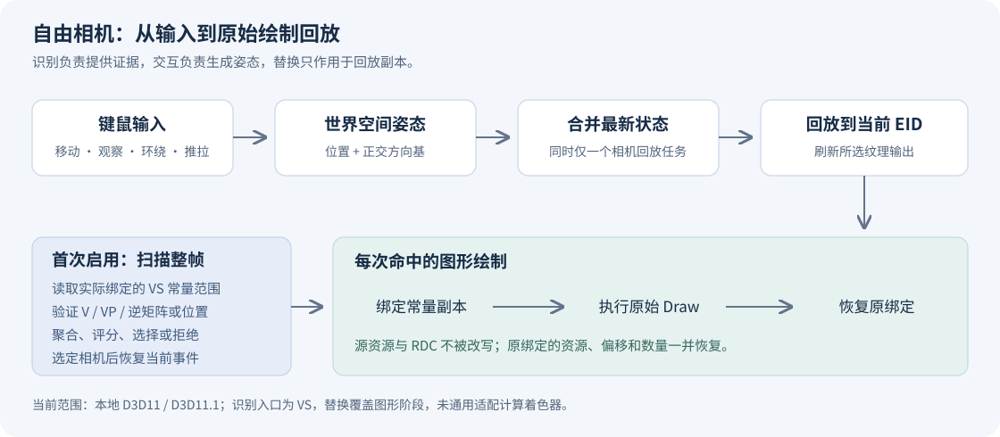
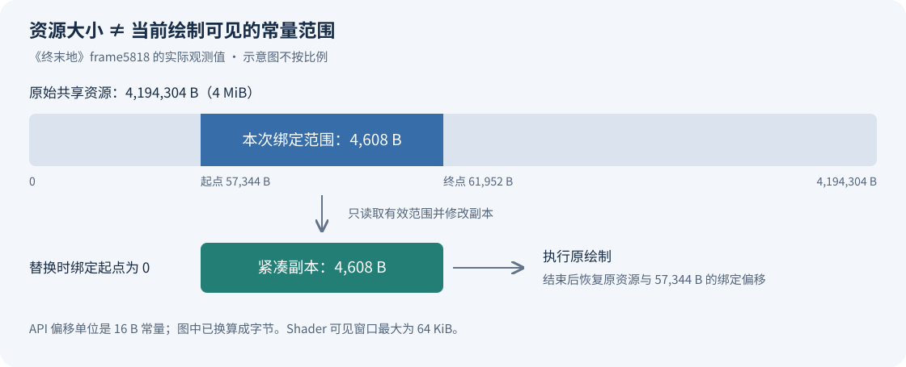

> 在保留原始绘制与材质的前提下，让一份 D3D11 截帧支持自由移动、环绕观察和视角复位。
>
> 技术栈：C++、Qt、RenderDoc、D3D11 / D3D11.1。本文对应 2026 年 9 月的实现与验证记录。

分析游戏画面时，我经常希望从侧面或背面观察角色、材质和场景结构。单张截图无法提供这些信息；进入 Mesh Viewer 虽然可以观察几何体，但我的目标是在实际回放画面中改变观察位置，同时保留原来的 Shader、材质和渲染过程。

为此，我在 RenderDoc 中加入了自由相机预览。它可以从任意 EID 启用，自动寻找主场景相机，支持 WASD 移动、QE 升降、鼠标观察与环绕，并能一键恢复截帧时的视角。开发过程中，真正困难的部分逐渐从“修改一个矩阵”，变成了“证明哪些数据属于相机，以及哪些数据应该随它变化”。

本文按实现原理、兼容性案例、性能和验证展开。这里的功能是基于 [RenderDoc](https://github.com/baldurk/renderdoc) 的个人扩展，当前支持本地 D3D11 / D3D11.1 回放。

## 1. 截帧里没有统一的 Camera 对象

游戏引擎中的 Camera 是一个高层概念，而 GPU 回放面对的是绘制命令、资源、Shader 和绑定状态。相机位置可能是常量缓冲区中的一个向量，视图矩阵可能被复制到多个 Shader 布局中，也可能只留下组合后的 ViewProjection。

因此，不能假定所有游戏都使用同一个槽位、变量名或矩阵偏移。即使源代码中存在 `View`、`InverseView` 等名称，它们也不一定在编译后的截帧里保留，更不保证其中的值与当前绘制一致。

我将问题拆成三个步骤：

1. **发现相机**：从绘制时实际绑定的常量中寻找满足数学关系的候选。
2. **维护相机状态**：把键鼠输入统一转成世界空间中的相机姿态。
3. **应用到回放**：为命中的常量创建替换副本，在绘制前绑定，绘制后恢复。



相机识别会扫描整帧，再恢复当前事件。识别结果在当前截帧中复用，因此不要求用户先找到某个角色 Draw Call。

不过，“任意 EID 可操控相机”并不意味着每个 EID 都有完整场景可看。选择清屏事件时没有场景几何体，选择 UI 或阴影输出时看到的仍是对应内容。自由相机不会提前执行尚未发生的绘制。

## 2. 通过矩阵关系识别相机

### 2.1 先约定矩阵的含义

为方便推导，本文使用列向量记法：

```text
p_clip = P · V · p_world
VP     = P · V
C      = inverse(V)
```

`V` 把世界坐标转换到观察空间，`C` 是相机到世界的变换，其平移部分给出相机的世界位置。代码读取常量时会分别尝试两种矩阵存储解释，并通过转置统一处理。存储布局与数学乘法约定需要分开理解。

自动识别以绘制时绑定的 VS 常量缓冲区为入口，在有效范围内按 16 字节步长检查 4×4 矩阵。它并没有实现任意打包方式的矩阵解码，也没有通用的 Shader 语义求解器。

### 2.2 完整矩阵组提供第一条证据链

首选路径寻找同一绑定范围中的 `V`、与之匹配的逆矩阵，以及至少一个 `VP`：

```text
V 是有限、近似正交的仿射变换
InvV ≈ inverse(V)
P = VP · inverse(V)
P 满足当前识别器接受的透视投影结构
```

检查包括齐次分量、基向量长度与正交性，以及投影矩阵中的关键元素。投影检查允许一定形式的反向深度、偏轴投影和抖动，但不等于接受所有投影形式。

单独找到一个刚体矩阵远远不够：物体变换、骨骼变换也可能具备相同结构。矩阵之间的一致性为候选提供了更强的证据。

同样，这仍是启发式识别。当前实现甚至主动排除单位视图矩阵，以减少误匹配，因此原点处的单位相机也存在漏检可能。

### 2.3 多相机竞争与拒绝机制

一帧中可能同时包含角色相机、UI 相机和其他辅助视角。识别器将近似相同的视图矩阵聚合，在有证据的绘制上累加视口面积作为权重：

```text
score(camera) = Σ max(1, viewport_width × viewport_height)
```

它表示候选在绘制中的参与程度，不是像素覆盖率，也不是统计意义上的置信概率。当前选择条件是最高分大于零，且不存在第二名，或最高分超过第二名的 1.15 倍。

完整逆矩阵路径有有效证据时，优先在这一路径内选择；后备路径不会随意覆盖原有参考值。没有候选和多个候选难以区分会返回不同错误，并记录候选位置、槽位、绘制次数及评分，供手动配置或后续诊断使用。

## 3. WXQ：相机存在，但存储的逆矩阵不一致

WXQ 的一份截帧揭示了首选规则的边界。它的主视图与投影关系有效，但常量中存储的逆视图与当前视图并不互逆。

在 frame74367 的一个场景绘制中，诊断结果如下。偏移均以字节计，属于该帧的观测值，不是程序中的游戏专用配置。

| 数据 | 绑定位置 | 结果 |
| --- | --- | --- |
| View | VS b3，偏移 144 | 有效刚体变换 |
| ViewProjection | VS b3，偏移 272 | 可恢复透视投影 |
| 存储的 InverseView | VS b3，偏移 208 | 与当前 View 不互逆 |
| 独立位置向量 | VS b1，偏移 64 | 约为 `(0, 0.2, 3.65)` |
| 从 View 反算的位置 | `inverse(V)` 的平移部分 | 同样约为 `(0, 0.2, 3.65)` |

`V × 存储的 InverseView` 与单位矩阵的最大绝对误差约为 4.71685，显然不能归因于普通浮点舍入。仅凭 RDC 无法确定游戏端为什么保留了不一致的数据，但足以说明“必须存在匹配逆矩阵”的规则过于严格。

修复时，我增加了第二条证据链：**有效 V + 有效 VP + 独立位置向量**。位置向量允许位于另一个 VS 常量槽，但必须与该次绘制绑定的视图一致，并至少在两次绘制中获得匹配。

这里有一个容易忽略的陷阱：逆矩阵自身的平移列就包含相机位置。如果把它再次当成“独立位置”，校验会退化成自我证明。因此，后备识别会排除属于已知矩阵或邻近刚体矩阵的向量。

完整路径与后备路径分别聚合候选，避免近似相同但并非逐位相等的数据改变旧路径的参考矩阵。兼容性修复不仅要让新截帧通过，还要维持原有截帧的精确复位与画面对比结果。

## 4. 从相机姿态生成替换常量

识别成功后，交互层持有位置以及 right、up、forward 三个方向向量，并保留截帧的观察方向约定。后端验证这些向量是否有限、近似正交且保持原有手性，然后构造新的相机变换。

设原视图为 `V₀`，新视图为 `V₁`，定义：

```text
Δ     = inverse(V₀) · V₁
V₁    = V₀ · Δ
VP₁   = VP₀ · Δ
InvVP₁ = inverse(Δ) · InvVP₀
```

这样可以在保留原投影的前提下更新匹配的视图和视图投影。逆矩阵的乘法方向相反，不能把同一变换机械地右乘到所有矩阵上。

跨 Shader 布局替换以已验证矩阵的数值关系为依据。不同编译变体中的相机常量即使偏移不同，也可以命中同一组模式；位置向量则根据对应路径的数值匹配或已验证绑定位置更新。自动路径没有使用游戏名称、固定 EID 或某个游戏的常量偏移作为分支条件。

实际绘制遵循以下生命周期：

```cpp
// 示意流程，不是可直接编译的完整接口。
BeforeDraw() {
    ReadOrReuseOriginalConstants();
    UpdateMatchingCameraConstantsInCopy();
    BindReplacementBuffers();
}

ReplayOriginalDraw();

AfterDraw() {
    RestoreOriginalBuffersAndBindingRanges();
}
```

修改只作用于回放使用的副本，不回写 RDC，也不覆盖源常量资源。当前替换覆盖 VS、HS、DS、GS、PS 图形阶段；相机发现从 VS 开始，计算着色器中的相机数据尚未获得同等支持。

复位也有专门处理：当姿态回到参考值时，跳过相机替换，让原始常量直接参与绘制。相比反复求逆并把结果写回，这能避免微小舍入误差破坏原图的逐像素一致性。

## 5. 平面反射与阴影：哪些应当随相机变化

WXQ 在相机能够移动之后，仍出现了地面倒影滑动的问题。只更新主视角时，反射渲染仍使用旧的观察矩阵；主画面却按照新的视角采样它，二者失去对应关系。

镜面和场景物体固定在世界中，并不意味着反射图像也应该固定。观察位置改变时，镜中看到的内容通常需要改变。相反，本案例的光源视图不应被主相机变换直接覆盖。

我把主相机候选与带斜裁剪的透视候选分开，只在验证了平面反射关系之后才建立联动。设世界镜像变换为 `M`，视图约定修正为 `F`，则关系可以写成：

```text
V_reflection = F · V_main · M
```

代码检查镜像变换是否近似满足仿射正交、行列式为 −1、自逆、只有一个反射轴，以及斜裁剪面的法线是否与镜面匹配，同时要求多次绘制证据和一致的焦距。

更新反射时，保留世界空间中的镜面裁剪平面，再根据新视角重建斜投影；把旧斜投影原样套到新视图上，不能保证裁剪平面仍固定在世界中。当前这套联动接在独立位置后备路径之后，不能据此宣称已经支持所有平面反射，更没有覆盖一般门户或任意多视角系统。

验证也不能只观察反射颜色是否改变。相机位置常量会影响视线相关着色，即使几何投影没动，颜色也可能变化。因此，WXQ 的回归同时读取了反射深度、反射颜色和阴影深度：反射几何应当更新，该案例的阴影图应保持一致，复位应恢复原始画面。

## 6. 《终末地》：4 MB 资源里的一小段相机常量

《终末地》frame5818 的失败原因完全不同。离线导出的数据中已经能找到相互一致的 V、InvV、VP，但运行时识别器却得到零个候选。

关键在于区分两个尺寸：**底层资源大小**与**Shader 当前可见的绑定范围**。

该帧一个绘制的常量资源为 4,194,304 字节，绑定起点为 57,344 字节，绑定长度只有 4,608 字节。旧代码以整个资源超过 64 KB 为由直接跳过，因此还没进入矩阵分析就排除了真正的相机。



D3D11.1 的 `VSSetConstantBuffers1` 可以指定可见常量窗口。API 的偏移与数量以 16 字节常量为单位，Shader 可见上限为 4096 个常量，即 64 KiB；这不能直接当作底层资源大小的上限。[Microsoft 官方说明](https://learn.microsoft.com/en-us/windows/win32/api/d3d11_1/nf-d3d11_1-id3d11devicecontext1-vssetconstantbuffers1)

修复后的流程是：按资源和绑定偏移缓存有效范围；根据范围长度验证矩阵；为需要修改的范围生成紧凑副本；把副本以偏移零重新绑定；绘制后恢复原资源、偏移和数量。上传、拷贝以及 discard 等操作会更新或使对应缓存失效。

在此之后，运行时得到两组候选：角色相机权重为 255,240,000，UI 相机为 197,280,000。原有 1.15 倍阈值已经足够区分它们，无需通过降低识别门槛掩盖数据读取问题。

### 6.1 识别到普通 VP，还不代表找到了实际使用路径

这份截帧还同时保留了普通 VP 与相机相对投影。诊断中观察到部分顶点着色器先减去相机位置，再用只包含旋转和投影的矩阵：

```text
普通路径：p_clip = P · V · p_world
相对路径：p_clip = P · R · (p_world − camera_position)
```

如果只更新普通 VP，实际使用第二条路径的几何体可能不按预期移动；如果把完整平移再次塞入相对矩阵，又可能重复施加平移。

当前实现从已验证的普通 VP 推导对应的 `P·R` 形式，并确认该矩阵确实出现在常量范围中，随后只更新它的旋转，同时更新独立位置向量。Shader 反汇编用于定位问题；运行时识别依赖矩阵关系，并未实现完整的数据流或分支分析。

## 7. 让操作在侧面和背面也保持一致

交互方案参考了 [Unity 的 Scene 视图导航](https://docs.unity3d.com/Manual/SceneViewNavigation.html)，但环绕中心采用视线前方的距离点，目前没有选中物体自动聚焦功能。

| 操作 | 行为 |
| --- | --- |
| W / S、A / D | 沿当前观察方向前后移动、沿相机右轴左右移动 |
| Q / E | 沿世界 Y 轴下降、上升 |
| 右键拖动 | 原地观察 |
| 中键拖动 | 沿当前画面平移 |
| Alt + 左键拖动 | 围绕支点旋转 |
| 滚轮、Alt + 右键拖动 | 沿观察方向推拉 |
| 右键按住时滚轮、Shift | 调节飞行速度、临时加速 |
| R / Reset view | 恢复原视角 |

最初出现过“正面正常，转到其他方向就反了”的问题。最终导航统一使用世界空间姿态：水平旋转围绕世界竖直轴，垂直旋转围绕当前相机右轴，并根据手性重建正交基；俯仰限制在约 ±89°。

平移和环绕也使用同一组基向量。设支点为 `pivot`，到支点距离为 `d`，环绕后的相机位置为：

```text
camera_position = pivot − forward · d
```

推拉采用指数距离变化：`d_new = d_old × exp(−amount)`，再对距离取上下限。这种操作移动的是相机位置，而不是修改 FOV，因而不应与透视镜头变焦混为一谈。

此外，松开按键、失去焦点、切换应用、关闭截帧或关闭自由相机都会清理移动状态，避免相机在用户停止操作后继续漂移。

## 8. 性能优化：减少重复读回与过期回放

自由相机的成本主要来自回放和数据访问，而不是几个矩阵乘法。初版反复读取 GPU 常量数据、创建替换缓冲区，并可能让鼠标事件产生过多回放请求，交互很容易出现明显延迟。

优化集中在四处：

1. **复用已知上传内容。** 在回放上传时维护 CPU 常量副本，只有内容未知时才从 GPU 读取，不能用未初始化的数据填补未知区间。
2. **跟踪失效。** 上传与拷贝使相关缓存失效；每次重新回放清理内容缓存，无法精确追踪的命令采用保守失效，避免使用上一遍的值。
3. **复用替换资源。** 使用可更新的动态常量缓冲区，减少反复创建和销毁 GPU 对象；大资源只处理绑定范围。
4. **合并交互请求。** 同时只允许一个相机回放进行，期间保留最新姿态。回放结束后若有更新，再提交最新状态，不为每一个鼠标事件排队。

异步回调还携带姿态版本号与截帧序号，用于避免旧回调覆盖新状态，或在用户换帧后继续操作旧截帧。

开发阶段曾在同一台机器、同一份 ZZZ 截帧上交替运行新旧版本，各三轮、每轮 30 个计时帧，得到以下记录：

| 项目 | 平均耗时 |
| --- | ---: |
| 优化前 | 310.85 ms |
| 优化后 | 28.42 ms |
| 耗时比 | 约 10.9 倍 |

计时包含等待 GPU 完成及读取最终图像，不包含 PNG 编码，**不能直接当作 GUI 帧率**。同期的七张参考输出保持一致。该数据是整理前的开发记录，原始日志与截图已清理，本文没有重新跑这组基准，也没有将它作为跨硬件、跨游戏的性能承诺。

不同截帧的识别成本也不同：ZZZ 的历史首次识别记录约为 150 ms，《终末地》的一次记录约为 3.47 s。首次整帧扫描与后续视角更新属于两种工作负载，不应混在同一个性能数字中。

## 9. 如何验证“相机真的改对了”

能看到画面变化只是第一步。开发阶段的验证关注以下几类不变量与变化：

| 维度 | 检查内容 |
| --- | --- |
| 相机发现 | 从场景事件、非绘制事件或 UI 事件启用，是否选中同一主场景相机 |
| 几何变化 | 平移、左右环绕、侧面与背面观察时，场景深度是否正确变化 |
| 精确复位 | 初始姿态、复位、关闭后是否恢复原始像素 |
| 数据保护 | 源常量与 RDC 是否保持不变 |
| 辅助视图 | WXQ 反射深度更新，阴影保持；《终末地》的不透明 UI 区域保持 |
| 导航数学 | 多个朝向、完整环绕、俯仰限制及观察方向约定 |

《终末地》的阴影验证还说明，不能对所有中间结果一律要求逐字节相等。该帧使用 4096×2048 的 D16 阴影图，光源投影没有改动，但 Shader 中对相机位置先减再加，会引入浮点消去误差。

五个测试视角下，阴影覆盖变化均为零，深度不同像素分别为 6、152、162、639、9 个，占全部 8,388,608 个像素的很小比例；其中超过一个 D16 量化阶的分别为 0、3、4、7、0 个。验证允许深度变化不超过 838 个像素，其中超过一阶的不超过 16 个，同时要求覆盖一致。最终画面复位仍要求逐像素恢复。

这些阈值针对该测试帧，不是所有阴影实现的统一正确性标准。尤其是级联阴影等依赖主相机的系统，可能需要重新拟合级联范围；当前实现并不重建游戏引擎的这一流程。

## 10. 一份截帧能够提供的边界

这项功能依靠的是截帧中已有的渲染数据。改变观察位置，并不会让游戏引擎重新模拟场景。

- **可见性不可重建。** 截帧前被剔除、没有进入命令流的对象不会凭空出现，大角度移动可能看到缺面。
- **历史帧不可重建。** TAA、时序降噪等仍可能使用原视角的历史数据，头发和透明边缘尤其容易留下噪点或残影。
- **屏幕空间结果有依赖。** 屏幕空间反射、遮挡及部分后处理可能与新视角不一致，选择后处理前的场景颜色输出通常更便于观察。
- **识别范围有限。** 当前主要处理 VS 常量中的完整 4×4 透视相机关系；只有组合 MVP、不同矩阵打包、纹理或 SRV 中的相机数据，以及纯正交视角等仍需另外适配。
- **辅助系统未全面覆盖。** 计算着色器、任意多相机、通用反射和复杂相机相关阴影不在当前完整支持范围内。
- **调试功能需要区分用途。** 已使用若干 Overlay 展示视角变化，但不能据此保证所有 Overlay、Mesh Viewer、Shader Replacement 和像素调试都与自由相机完全一致。分析原始帧时应关闭该功能。